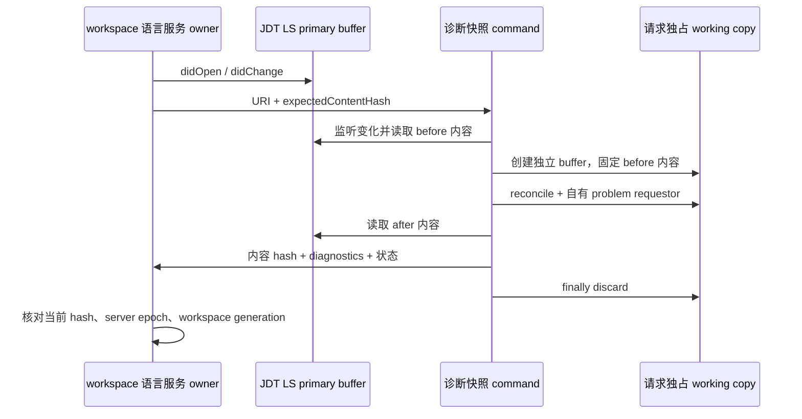

# Java 诊断快照扩展

本扩展属于通用代码开发插件的 Java 后端，随固定的 JDT LS `1.62.0.202610131109` 和 tooling Java 25 分发。它只提供宿主内部使用的 `zcode.java.diagnosticsSnapshot`，不向 Agent 开放任意 `workspace/executeCommand`。

## 协议与所有权

输入为 `arguments: [{ uri, expectedContentHash }]`。hash 是实际文本按 UTF-8 编码后的 SHA-256，不归一化换行。宿主先发送文档同步通知，再请求快照。

JDT LS 的 primary working copy 仍由其文档生命周期处理器唯一维护。扩展读取该副本的内容，为每次请求创建独立 `WorkingCopyOwner` 和临时 working copy，收集该副本 reconcile 的 compiler problems；不修改、保存或提交 primary buffer，不发布诊断通知。

响应包含 `uri`、`status`（`current`、`stale`、`unavailable`）、`analyzedContentHash`、`beforeContentHash`、`afterContentHash`、`changedDuringAnalysis`、标准 LSP `diagnostics` 及可选 `reason`。未获得的 hash 可省略。



只有实际 reconcile 已完整报告、primary buffer 没有变化且前后内容一致，扩展才返回 `current`。变化监听覆盖内容变化后又恢复的情况。取消不产生 current 结果，所有路径都释放监听器和独立副本。宿主仍须在接收响应时检查其最新内容和运行代次；过时响应不能形成当前诊断摘要。

该证据证明目标文件的内容，不代表整个项目依赖处于事务快照。项目导入和构建状态由宿主单独报告。JDT LS 原生无版本 `publishDiagnostics` 不自动提升为 current。扩展不读取私有 `documentVersions`，也不将客户端 version 回显为服务端证明。`workspace.run` 无法阻止 `didChange` 修改内存文档，不能作为版本锁。

## 构建与升级边界

从仓库根目录运行：

```powershell
node apps/zcode-cli/packages/code-development-plugin/scripts/build-java-extension.mjs --jdtls-home <JDT_LS目录> --java-home <Java_25_JDK目录>
```

产物为包内 `dist/java/zcode-java-extension.jar`。通过 JDT LS `initializationOptions.bundles` 加载其绝对路径。构建使用已锁定发行包的 plugins JAR，不下载依赖。

`IDelegateCommandHandler`、`JDTUtils`、`BaseDiagnosticsHandler` 属于 JDT LS 内部 API；本扩展与 JDT LS 必须一起锁定、编译和验证，不独立升级。首要验收为真实进程加载扩展、带错误文件、修复后空诊断、hash 不符返回 stale，以及取消后后续请求仍可成功；临时验证脚本不随源码保留。
