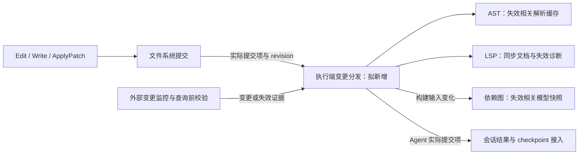

# Agent 基础工具优化

状态：ToolSearch 与 ApplyPatch 已实现；LSP、AST、Dependency Graph 保留设计待定。更新：2026-10-11。验证结果及未执行项见 [验证记录](VERIFICATION.md)。

本目录集中维护 Java LSP、ToolSearch、AST、Dependency Graph 与 ApplyPatch 的设计、源码依据和验收场景。具体产品规则以各专项规范为准；接口提案和待冻结项不能作为已实现能力展示。

## 当前实施范围

用户已确认先实现 `ToolSearch` 和 `ApplyPatch`，作为 Agent 基础工具。保持已确认的 14 个现有常驻工具并增加 `ToolSearch`，`ApplyPatch` 通过搜索按需加载。LSP、AST、Dependency Graph 的能力与软件开发插件方案均保留设计，待这两个工具完成后再决定；本轮不注册占位工具、不增加语言运行环境或分析服务。

## 设计文档

| 文档                                               | 内容                                                                                             |
| -------------------------------------------------- | ------------------------------------------------------------------------------------------------ |
| [Java LSP 规范](java-lsp/SPEC.md)                  | Java 优先；导航、符号、诊断和文档同步；随包启动环境；项目 JDK 自动匹配、对话配置，无设置页入口。 |
| [Java LSP 核心验收](java-lsp/ACCEPTANCE.md)        | 启动、项目导入、JDK 缺失、文档同步、诊断与会话共享的代表场景，均为 planned。                     |
| [ToolSearch 规范](tool-search/SPEC.md)             | 基础 Agent 与 MCP 工具统一发现；常驻名单、token 预算、保留与恢复、受限子代理边界。               |
| [工具定义开销基线](tool-search/SCHEMA-BASELINE.md) | 当前工具定义的逐项估算、统计口径和模型/配置差异，为可调预算提供依据。                            |
| [ApplyPatch 规范](apply-patch/SPEC.md)             | 文本文件新增、修改、删除、移动；全量预检、逐项提交、部分成功反馈与核心验收。                     |
| [AST 规范](ast/SPEC.md)                            | Java 优先的结构筛选与片段提取；语法候选、版本缓存和结果边界。                                    |
| [Dependency Graph 规范](dependency-graph/SPEC.md)  | Java 项目模块关系、正反向依赖及有依据的影响路径；模型来源与新鲜度。                              |

## 能力分工与已确认范围

| 能力             | 职责                                                 | 与其他能力的边界                                                                                               |
| ---------------- | ---------------------------------------------------- | -------------------------------------------------------------------------------------------------------------- |
| ToolSearch       | 查找获准工具并按预算加载定义。                       | 加载不授予执行权限，不等于启动或停止分析服务。                                                                 |
| LSP              | 符号绑定、导航、引用、类型信息与诊断。               | 不能假设标准 LSP 提供任意 AST 或完整项目依赖图。                                                               |
| AST              | 常用结构筛选与片段提取：节点类型、注解、方法签名等。 | 此范围已确认；首版不包含占位符模式 DSL。语法匹配不证明符号或类型相同。                                         |
| Dependency Graph | 组织有来源的关系，查询依赖方向及潜在影响路径。       | 首版方案从 Java 有效项目模型的模块关系开始，符号级影响留作后续；结果说明覆盖范围。                             |
| ApplyPatch       | 将结构化补丁应用到文本文件。                         | 已确认支持新增、修改、删除和移动；全部预检通过后逐项提交，途中失败报告实际已完成与未完成项，不要求跨文件回滚。 |

`ApplyPatch` 已通过 ToolSearch 按需加载。`LSP`、`AST`、`DependencyGraph` 保留相同的按需加载设计，不注册尚未实现的工具定义；AST 和图工具的名称及具体参数仍为提案。

## 共享事实与状态边界

| 状态                          | 所有者与来源                                     | 约束                                                                     |
| ----------------------------- | ------------------------------------------------ | ------------------------------------------------------------------------ |
| 已提交文件内容与 revision     | 既有文件系统端口及执行端文件系统。               | 分析缓存和补丁计划不成为第二个文件事实源。                               |
| 补丁预检计划与提交结果        | 当前工具调用；结果进入既有会话链。               | 记录逐项实际提交情况，不把预检通过或 checkpoint 写入成功等同于文件提交。 |
| AST 解析缓存                  | 拟议执行端 workspace 分析服务。                  | 按文件 revision 与解析配置派生，可丢弃重建。                             |
| JDK 登记与明确选择            | 拟新增执行端 JDK 配置 owner；当前对话提交意图。  | 配置持久保存，发现缓存可重建；项目按各自约束派生选择，不逐工作目录配置。 |
| Java 文档、诊断及有效项目模型 | Java LSP 规范中的 workspace 语言服务 owner。     | 同 owner 共享，不因加载多个分析工具而分别导入相同项目。                  |
| 模块图快照                    | 拟议执行端图服务，从经过验证的有效项目模型派生。 | 不复制项目 JDK 选择逻辑，不用文件 import 数量代替有效模块依赖。          |
| 工具加载与结果展示            | 会话 Runtime；客户端仅投影。                     | AST/图缓存随 workspace 生命周期管理，按需 schema 卸载不销毁共享缓存。    |

以下变更分发是拟新增设计，当前 FileSystemPort 尚无完整订阅接口，现有 checkpoint 也不是实时变更总线：

- Agent 写入后的缓存失效应在后续分析查询前登记；查询验证当前 revision 和模型状态，不用固定延时等待。LSP 同步已发送与诊断完成仍是两种状态。
- ApplyPatch 部分成功时，已提交项仍更新 read-state、失效缓存并进入变更记录；失败或未执行项不能伪造提交事件。不能以整次调用 `success=false` 为由漏掉已提交部分，也不能依赖可选 artifact 写入成功才更新分析缓存。
- 普通源码内容变化不必重建整个模块图，但会影响 AST、LSP 及文件到模块的映射；构建配置、项目导入环境变化才按实际依赖输入失效模块图。无法证明覆盖范围时返回相应不完整状态。
- 缓存隔离沿用 `workspaceIdentity?.trim() || workspacePath`，再区分项目与分析配置；`workspacePath` 用于实际 I/O，远端关联保留 `remoteSessionId`。进程和缓存都在工作区实际执行端。
- bootstrap 管理 workspace 资源借用与释放；Main、relay、Renderer 不承担分析事实所有权。手机复用现有 Host attachment，Desktop 保持 `desktop-continuous`，手机恢复保持 `web-remote-replayable`；重放历史结果不重放补丁写入。
- 优先复用现有工具调用及结果展示；新增 contracts 输出必须严格校验，需要新增协议字段时同步 shared schema、V4 投影与恢复链。本轮不设计独立 AST 浏览器或可视化依赖图页面。

## 实现边界与顺序

| 能力             | 当前入口与拟议落点                                                            | 状态        |
| ---------------- | ----------------------------------------------------------------------------- | ----------- |
| Java LSP         | 拟接 core handler、contracts port、adapters 与 bootstrap 资源 owner。         | proposed    |
| ToolSearch       | 统一 registry 提供获准目录，Runtime ToolExposureState 管理请求定义与恢复。    | implemented |
| ApplyPatch       | handler、逐目标权限、条件文件提交、部分结果与多文件 checkpoint/rewind。       | implemented |
| AST              | 无 Agent handler；拟接 contracts 分析端口、parser adapter 与 workspace 缓存。 | proposed    |
| Dependency Graph | 现有 TS/JS 仓库脚本仅作参考；拟接 Java 有效项目模型与图查询端口。             | proposed    |

1. 本轮先实现 ToolSearch：统一基础 Agent 与 MCP 的发现、按需定义、预算与恢复，受限子代理搜索范围保持原有效白名单。
2. 同轮实现 ApplyPatch：结构化文本补丁、全量预检、逐目标权限、部分成功报告与多文件 checkpoint/rewind，接入 ToolSearch。
3. 完成上述两项后，再讨论软件开发插件及 Java LSP、AST、Dependency Graph 的实现范围和顺序。既有 Java 优先、随包启动环境及对话式 JDK 配置决策保留，但不构成本轮依赖。

ToolSearch 的默认预算与两个基础工具接口已经落实。解析后端、Java 资源版本及软件开发插件等待定事项保留在各自规范中，不构成本轮已实现能力。验证证据与实机验收边界见 [验证记录](VERIFICATION.md)。
