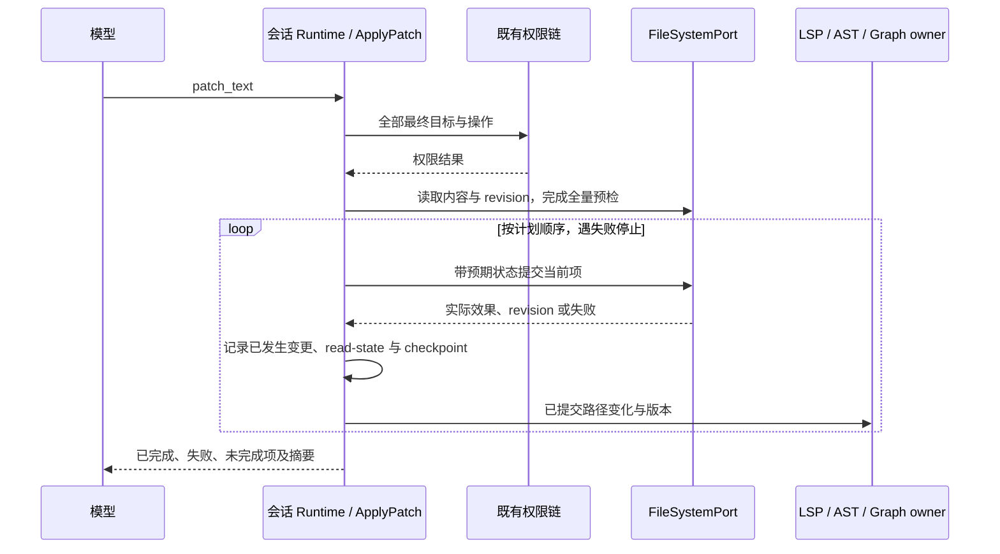

# ApplyPatch 结构化补丁规范

状态：已实现，与 ToolSearch 联合验证；自动化证据及未执行的实机验收见 [验证记录](../VERIFICATION.md)。更新：2026-10-11。

本规范属于 [Agent 工具优化](../SPEC.md)。ApplyPatch 已加入常驻候选名单，当前会话获准时首个模型请求即携带完整定义，无需先调用 [ToolSearch](../tool-search/SPEC.md)；白名单、禁用规则和执行权限继续生效。

## 1. 已确认的产品规则

- 首版覆盖文本文件的新增、修改、删除、移动；一次调用可以包含多个文件和多个 hunk。
- 全部条目预检通过后逐项提交。中途失败停止后续提交，如实返回已完成、失败和未完成项，不要求跨文件事务回滚。
- 本轮实现补丁解析、条件写入、权限、结果与恢复；LSP/AST/Graph 消费和通用分析通知留待后续，不引入尚无消费者的分析框架。
- `Edit` 保留单文件字符串替换，`Write` 保留创建或整体写入；ApplyPatch 用于以局部 diff 表达相关改动，减少多次调用。
- 补丁处理与语言无关；首版不覆盖二进制补丁、权限位变更，不提供语义重命名或任意 LSP `WorkspaceEdit` 执行。
- 保留已有文件的权限位属于移动和恢复语义，不开放补丁输入修改权限位的能力。执行端文件系统读取原权限并负责创建时恢复，core 仅通过 FileSystemPort 传递；Windows 沿用平台实际支持的权限语义。
- 已有目标仅接受普通文本文件，沿用写入端的符号链接拒绝策略；预检与条件提交均不得跟随符号链接，以免将链接目标内容误记为可恢复的普通文件快照。

## 2. 实现入口

| 已核实入口                                                                               | 当前能力与缺口                                                                 |
| ---------------------------------------------------------------------------------------- | ------------------------------------------------------------------------------ |
| `apps/zcode-cli/packages/contracts/src/tools/apply-patch.ts`                             | 严格输入/输出 schema，逐项状态、实际提交路径、前后 revision 及文本格式元数据。 |
| `apps/zcode-cli/packages/core/src/tool/handlers/apply-patch.ts`                          | 已注册 handler；解析、预检、权限目标提取分别由同目录 helper 负责。             |
| `apps/zcode-cli/packages/core/src/tool/executor/permission-input-recheck.ts`             | 用户修改补丁输入后，校验新的全部目标；原输入获批不能覆盖新目标的拒绝规则。     |
| `apps/zcode-cli/packages/adapters/src/fs/conditional-write.ts`                           | 条件替换、排他新增、内容 hash 校验；删除复用相同 revision 检查。               |
| `apps/zcode-cli/packages/core/src/runtime/helpers/rewind.ts`；`runtime/methods/tools.ts` | 从已提交项生成多文件 checkpoint，即使工具失败也先记录真实 turn changes。       |
| `apps/zcode-cli/packages/contracts/src/rewind/index.ts`                                  | `afterContent: null` 表示删除；缺失字段继续兼容旧 artifact。                   |
| `apps/zcode-cli/packages/core/src/tool/executor/file-diff-display.ts`                    | 从实际提交项生成有界多文件展示，复用现有 Changes UI。                          |

## 3. 状态所有者与分层

| 状态或职责                  | 唯一所有者                               | 派生视图与边界                                             |
| --------------------------- | ---------------------------------------- | ---------------------------------------------------------- |
| 工具定义与 handler          | 当前 Runtime 的 ToolRegistry             | ToolSearch 只决定定义是否加载，不能授予写权限。            |
| 补丁解析与提交计划          | core 的 ApplyPatch handler               | 计划为单次调用局部状态，不是新的全局任务队列。             |
| 文件内容、存在性和 revision | 执行端文件系统及 FileSystemPort adapter  | 预检快照、diff、LSP buffer 和 AST/Graph 缓存均非写入事实。 |
| 权限及用户修改后的输入      | 既有 executor、permission service/broker | 按最终补丁重新校验，hook 别名不绕过目标权限。              |
| 实际变更记录与 checkpoint   | 会话 Runtime                             | 记录已经提交的效果，供 Changes、恢复和后续分析派生。       |
| 文档、解析和依赖缓存        | 各 workspace 分析服务 owner              | 接收已提交变更，失效或更新自己的缓存，不反向覆盖文件。     |

core 经 contracts port 使用异步 I/O；平台文件操作位于 adapter，bootstrap 注入。禁止为 ApplyPatch 绕过 FileSystemPort 直接执行 shell 补丁命令。

## 4. 工具接口

首版采用 `ApplyPatch({ patch_text })` 和以下结构化格式，由严格的输入 schema 与补丁解析器共同验证；不声称兼容所有 unified diff、git diff 或第三方 patch 格式。

```text
*** Begin Patch
*** Add File: src/new.ts
+export const value = 1;
*** Update File: src/current.ts
@@
-const oldValue = 1;
+const oldValue = 2;
*** Delete File: src/obsolete.ts
*** Update File: src/old-name.ts
*** Move to: src/new-name.ts
@@
-export const label = "old";
+export const label = "new";
*** End Patch
```

- 移动允许同时修改源文件内容；输入顺序决定提交顺序，解析结果显式列出源路径、目标路径及 hunk。
- 路径解析复用现有 workingDirectory/workspaceRoot 约定；此路径归一化不等于权限检查。
- 输出：调用级 `status: completed/partial/failed`、有序 `operations[]`、`committedChanges[]` 和简短 `summary`；取消作为停止原因记录。
- 每个操作返回类型、源/目标路径、`applied/failed/not_attempted/unconfirmed` 及失败原因；未能确认的提交单独标明，不能猜成成功。
- `committedChanges[]` 只列实际发生的路径变化、前后存在性、revision 和有界 diff；完整前镜像由内部 checkpoint 保存，不重复灌入模型上下文。
- 移动若发生目标已创建而源未删除的部分效果，必须列出两端真实状态，不能只报笼统的“移动失败”。

## 5. 全量预检与逐项提交

1. 完整解析补丁，检查格式、操作范围和目标冲突，形成固定提交计划；语法失败时不写任何文件。
2. 解析所有实际目标并按操作检查权限：修改/删除检查原路径；新增检查目标；移动同时检查源和目标。任一拒绝或待确认未完成时不开始提交。
3. 对已有文件沿用当前先 Read 再修改的 read-state 规则，确认当前内容与已读 revision；handler 为预检而读取文件不能伪装成模型已 Read。
4. 在预检内容上计算每个 hunk 的结果，匹配缺失或有歧义时明确失败；不串接多层模糊匹配。新增/移动目标已存在时不覆盖。
5. 全部预检通过后依序提交；每项仍检查预期源 revision 与目标存在性，预检不是对后续外部修改的锁定。
6. 提交成功后立即记录实际效果并更新 read-state；第一项失败或取消后停止，保留此前完成项，后续条目标为未执行。

文件端口以 `expectedRevision` 校验源版本、`expectedMissing` 排他创建目标；删除携带预期 revision，移动分目标创建与源删除两步记录实际结果。`writeTextFile.atomic` 不代表跨文件事务，版本检查与最终 OS 提交之间仍不是对外部进程的锁定。

移动可由明确的文件操作步骤实现，但必须保留每步实际效果；失败后不自动撤销其他已完成项。编码和 LF/CRLF 处理复用现有文本文件策略，避免补丁携带的换行格式无意改写整文件。

新增/修改后的 read-state 记录新 revision；删除使原路径缓存失效；移动使旧路径失效并记录目标最终状态。重复投递结果不重复写文件；模型重试补丁是新调用，必须重新预检。

取消采用提交边界上的协作停止：尚未开始的文件不提交；已开始的单路径写入或删除先收集实际结果，再停止后续步骤。executor 通过工具声明的 `cancellation.settlement: afterHandler` 等待最终事实，不能提前丢弃 handler 的部分结果。handler 返回完整结构化输出，`resolveOutputError` 将 partial/failed 投影为失败状态，仍保留实际变更、diff 和恢复元数据；后置 hook 失败也不得擦除已经返回的提交事实。

## 6. 变更提交、分析同步与事件顺序

本轮落实实际已提交路径、revision、read-state、turn changes 与 checkpoint；以下分析 owner 通知为后续设计，不随本轮创建服务或后台进程。实际变更记录不依赖可选 artifact 成功，未来分析消费者应在这一事实边界接入。



- 统一变更通知属于拟议 contracts 接点，供 Edit/Write/ApplyPatch 共用；包含 workspace identity、会话/调用关联、实际源/目标变化与 revision。
- 只有实际文件变化才通知分析 owner；失败条目中已经发生的部分效果也必须通知，未提交计划不能污染缓存。
- LSP 按文档顺序同步与失效旧 URI；AST 按文件 revision 失效解析；Dependency Graph 按实际构建输入失效模块图，文件移动等变化更新源码到模块的映射，普通方法体编辑不无条件重建模块图。查询时分别报告对应视图的新鲜度。
- 通知不能依赖可选 checkpoint artifact 成功。分析服务不可用或通知失败，不将已经完成的文件提交伪报为失败，也不重新执行补丁；后续查询按当前文件 revision 校准。
- 不把通知发送完成当作索引或 diagnostics 已完成，不使用固定 sleep 作为同步屏障。

## 7. 多文件 checkpoint 与恢复

- 一次调用以实际提交的每个路径为单位保存前后状态及 diff，移动需要覆盖源与目标；`fileCount` 表达实际变更路径数量。
- 新增的前状态为不存在，删除的后状态为不存在；需让 checkpoint schema 和 rewind 显式区分不存在与空文本，不能仅用空字符串代表删除。
- 部分成功仍记录已完成效果，不能沿用当前 `result.success === false` 就跳过全部 checkpoint 的路径；模型摘要与内部前镜像分开存放。
- checkpoint 失败单独报告恢复不可用，不假装写入未发生。用户主动 rewind 复用现有冲突检查，不因支持恢复就自动回滚补丁。
- cold resume 或工具结果重放不重新执行补丁。中断后无法确认的项先核对磁盘及已保存记录，不推断整批全部成功或全部失败。

- 已有文件的 `beforeEncoding` 与 `beforeLineEndings` 随实际提交记录和 checkpoint 可选保存；rewind 写回原编码与主换行策略，失败补偿采用补偿前实际读取到的编码和换行。旧 artifact 缺少这些字段时保留既有默认行为；仍使用 FileSystemPort 的规范化文本与主换行规则，不新增 raw 文本或混合换行模型。
- 文件权限位同样作为可选前镜像元数据保存。移动目标在发布前继承源权限，删除或移动后的 rewind、workspace fork 以及恢复失败补偿均沿用对应快照权限；旧 artifact 缺少此字段时维持原默认行为。文件属性仍由执行端文件系统拥有，checkpoint 只是恢复快照，不新增独立权限状态。

## 8. Desktop、Web 与远程边界

工具结果的 UI 投影使用兼容现有 `file_diff` 的 `file_diffs` 展示载荷：`{ kind: "file_diffs", files: FileDiff[], totalFiles?: number, truncated?: boolean }`。每个 FileDiff 沿用单文件的路径、增删行数、structuredPatch 和截断标记；只从 `committedChanges` 生成，失败和未执行项不能伪造文件变更。展示最多 32 个路径，整体最多 160 行 diff，每个路径最多 8 个 hunk；被截断时显式标记，完整快照仍在 checkpoint 中。

审查修复补充可选 `totalFiles`：由 Runtime 从实际提交路径计算，随 display 进入实时事件和冷恢复，旧载荷仍可读取。UI 直接派生展示，不缓存第二份事实；有总数时显示真实变更文件数，路径裁剪时说明“仅展示 32 / 33 个文件”，仅 diff 内容裁剪时也显示预览不完整。旧载荷只有 `truncated` 时明确提示预览截断，不推断未知总数。Desktop 与手机 Web 共用组件与本地化文案。

Runtime 持久化 completed/error tool part 时都保留 display；实时 ToolCallResult 与冷 transcript hydration 的 error 结果都携带同一载荷。V4 `toolOutputSchema.display` 增加 `file_diffs` 分支，旧 `file_diff` 仍可解析。Desktop continuous 与 Web replayable 消费同一投影结果，恢复时只还原展示和已提交版本，不再次执行补丁。

| 入口                 | 行为与所有者                                                                                           |
| -------------------- | ------------------------------------------------------------------------------------------------------ |
| Desktop              | `desktop-continuous` 通过原 Runtime 执行；UI 展示逐项 diff、权限请求与实际结果。                       |
| 手机 Web             | `web-remote-replayable` 连接已有 Host attachment，恢复同一调用结果；重连不重新应用补丁、不另起 Agent。 |
| 远程 workspace / CLI | FileSystemPort 在所属执行端解析和写入；保留 `remoteSessionId`，不把远端路径交给本地文件系统。          |

隔离统一使用 `workspaceIdentity?.trim() || workspacePath`，路径用于执行与展示；跨 Host owner/lease、请求关联和 stale run 规则沿用现有边界。

## 9. 核心验收场景

自动化测试已覆盖 AP-1 至 AP-4 的核心行为，以及 AP-5 的 runtime、checkpoint 和两类协议投影；实际 Desktop/手机断线重连仍未执行，详细证据见 [验证记录](../VERIFICATION.md)。

| 场景                | 准备                                                   | 动作                                           | 断言                                                                                              | 必要证据                                           |
| ------------------- | ------------------------------------------------------ | ---------------------------------------------- | ------------------------------------------------------------------------------------------------- | -------------------------------------------------- |
| AP-1 四类文本操作   | 已读且版本新鲜的文本文件，准备新增目标与移动目标       | 一次提交新增、修改、删除、移动                 | 磁盘符合补丁；read-state、逐项结果和 checkpoint 覆盖全部实际路径                                  | 文件内容/revision、工具结果、checkpoint artifact   |
| AP-2 全量预检阻断   | 两项补丁，第一项合法，第二项目标权限拒绝或 hunk 不匹配 | 执行补丁                                       | 第一项也未提交；错误定位到失败条目，无变更通知                                                    | 权限/预检结果、文件前后对比、通知记录              |
| AP-3 中途部分成功   | 全量预检通过；可控 adapter 令第二项提交失败            | 执行三个条目，再以一个移动步骤失败验证两端报告 | 已完成项保留、失败项实际效果完整、后续项未执行；checkpoint 不漏记                                 | adapter 调用记录、文件状态、逐项结果、恢复记录     |
| AP-4 版本与变更记账 | 已读文件被外部修改；另准备有效新读取与 artifact 失败   | 提交旧补丁，再重新 Read 并提交新补丁           | 旧补丁不覆盖外部修改；新提交更新 read-state 与 turn changes，即使 artifact 失败也保留实际变更事实 | revision、磁盘状态、提交结果与 turn changes        |
| AP-5 恢复与客户端   | Desktop 完成一次部分成功调用；手机连接同一 attachment  | 手机断线重连并恢复结果，随后主动检查 rewind    | 结果重放不再次写入；实际文件与已提交记录一致，恢复遵守现有冲突检查                                | E2E 会话事件、文件写入次数、checkpoint/rewind 结果 |

仅用代表性的权限拒绝、一次提交失败和一次版本冲突验证边界，不生成语言、平台、操作类型的笛卡尔测试矩阵。二进制及跨文件事务场景按首版范围排除。

审查修复验收：移动可执行脚本和私有文本文件后权限保留，删除/移动后恢复沿用原权限；一次提交 33 个文件时总数为 33、预览为 32 且有裁剪提示，少量文件超过 diff 行预算时仍提示内容裁剪；桌面与窄屏的实时/恢复展示使用相同载荷语义。验证脚本仅临时存在，执行后删除；无法执行 POSIX 或实机场景时如实记录边界。

## 10. 实施与验证落点

实施依次补齐补丁解析/contract、逐目标权限与文件端口、handler 注册、部分成功结果/read-state、checkpoint 和 turn changes。保持业务 owner 与原工具链一致，不另造通用事务框架；分析消费者后续单独实施。

已核对 `@zcode/core` package scripts：有 typecheck、lint，无统一 test script。本轮使用 `node:test` 临时脚本完成验证，相关 `.test.ts` 源码现已移除；后续验证按实际临时入口记录命令和结果，执行后删除脚本、不随源码提交。AP-5 需要运行时/E2E 证据，不能拿单测替代。

已执行命令与结果统一记录在 [验证记录](../VERIFICATION.md)。文档与静态检查不能代替文件写入、权限或恢复行为的证明。
