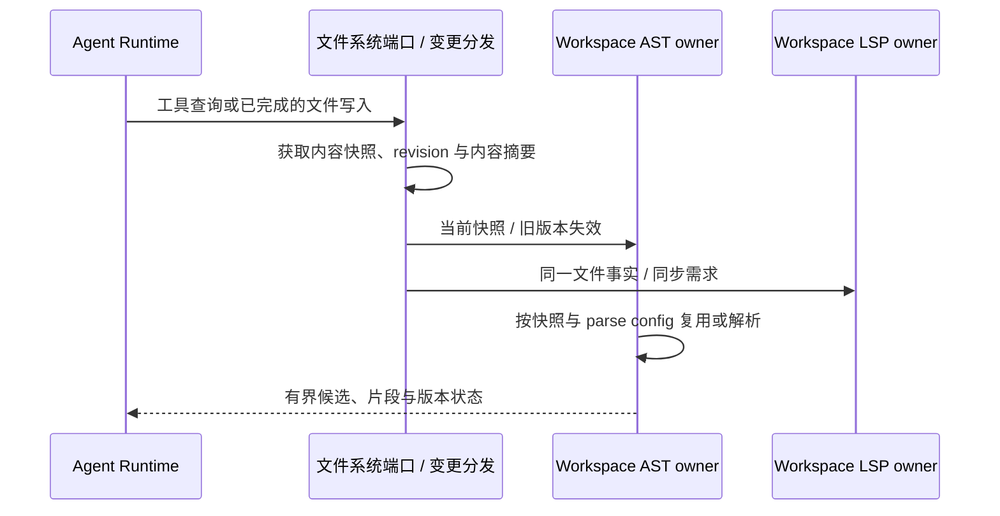

# Agent AST 结构查询规范

当前排期：作为 [通用代码开发插件](../code-development-plugin/SPEC.md) 的后续能力模块保留设计待定；该插件首版仅交付 Java LSP，本轮不实现 AST。下文“首版”均指未来 AST 模块自己的首版，不属于插件当前首版交付范围。

状态：`proposed`，产品范围已确认，接口与实现方案待验证，尚未实现。更新：2026-10-16。

本轮只编写设计文档，不注册工具、不修改业务源码或 schema。所属专题见 [Agent 工具优化](../SPEC.md)，语义服务边界见 [Java LSP](../java-lsp/SPEC.md)，工具发现见 [ToolSearch](../tool-search/SPEC.md)。

## 1. 已确认范围与职责

- Java 优先；TS/JS 后续接入，不作为 Java 首版交付前提。
- 首版支持常用结构筛选与源码片段提取：节点类型、声明名称、注解、方法签名等。
- 不提供占位符 DSL、任意结构模式、用户脚本执行或直接修改语法树；不向模型输出整棵大 AST。
- AST 回答“源码写成什么结构”，LSP 回答“符号绑定到哪里、类型是什么、引用和诊断如何”。
- 注解名、参数类型、继承声明和调用表达式均是语法候选；没有绑定证据时，不宣称其全限定类型、真实调用目标或跨文件引用关系。
- AST 可为 Dependency Graph 提供带来源的语法候选；图的边类型、解析完整性与语义补全由图能力自己的规范定义。
- `AST` 作为拟议 canonical tool name，沿 ToolSearch 按需加载；加载定义不等于启动 parser，也不授予读取权限。

## 2. 当前源码依据

| 已核验入口                                                                                                                                                                     | 当前事实与设计约束                                                                      |
| ------------------------------------------------------------------------------------------------------------------------------------------------------------------------------ | --------------------------------------------------------------------------------------- |
| [工具注册表](../../../apps/zcode-cli/packages/core/src/tool/handlers/index.ts)                                                                                                 | 没有 AST handler；不能将仓库内部使用解析库等同于已有 Agent AST 能力。                   |
| [FileSystemPort](../../../apps/zcode-cli/packages/contracts/src/interfaces/file-system.port.ts)、[文件 adapter](../../../apps/zcode-cli/packages/adapters/src/fs/index.ts)     | 读取结果已有 revision 与可选 hash；stat 的 mtime/size 标识不能独自证明解析内容未变。    |
| [Edit](../../../apps/zcode-cli/packages/core/src/tool/handlers/edit.ts)、[Write](../../../apps/zcode-cli/packages/core/src/tool/handlers/write.ts)                             | 成功写入后更新会话读取状态，尚无共享 AST/LSP 文件失效链路。                             |
| [路径解析](../../../apps/zcode-cli/packages/core/src/tool/path-policy.ts)、[Read 权限](../../../apps/zcode-cli/packages/core/src/tool/handlers/read.ts)                        | 复用现有路径与 read 权限链；路径解析当前不硬性禁止 workspace 外路径，不能虚构已有沙箱。 |
| [Host 文件 watcher](../../../packages/services/src/fileWatcher/fileWatcherService.ts)                                                                                          | 目录刷新可能合并多个变更，不是精确文档 revision 或解析完成证明。                        |
| [app 装配](../../../apps/zcode-cli/packages/bootstrap/src/app/create-app.ts)、[资源 owner](../../../apps/zcode-cli/packages/bootstrap/src/zcode-protocol/runtime-resources.ts) | adapter 注入、资源共享和退出清理由执行端 bootstrap 装配；AST 资源 owner 为新增设计。    |

## 3. 拟议工具接口

首版以显式文件为有界输入；工作区找文件继续使用既有文件搜索，不隐式递归解析整个仓库。
以下字段是接口提案，最终名称与有限枚举须在 parser 验证后固化到 contracts；不是现有 schema。

| 字段                                 | 提案语义                                                                                           |
| ------------------------------------ | -------------------------------------------------------------------------------------------------- |
| `operation`                          | `query` 返回结构候选；`extract` 按候选引用提取声明或主体片段。                                     |
| `file_path`                          | 目标源码文件；身份、执行环境和 cwd 来自可信工具上下文，不允许输入另一个 workspace identity。       |
| `filter.node_kinds`                  | 有限节点类别，如 class/interface/enum/record/method/constructor/field/import；只承诺经验证的类别。 |
| `filter.name` / `filter.annotations` | 按源码声明名称和注解名筛选；明确精确文本语义，不自动展开 import、别名或继承注解。                  |
| `filter.method`                      | 方法名、参数类型文本、返回类型文本与修饰符等有限条件；不做重载绑定、类型等价或泛型推导。           |
| `node_ref` / `fragment`              | `extract` 使用 query 返回的版本绑定引用；`fragment` 选择 declaration/body，不能作为文件权限凭证。  |
| `limit` / `cursor`                   | 有界结果与继续读取；cursor 绑定文件 revision、parse config 和查询，文件变化后失效。                |

- 多个筛选维度按 AND 组合；同一列表内按 OR 匹配。签名文本仅允许明确定义的语法空白规范化，不把 `List` 与 `java.util.List` 判为同一类型。
- query 返回有限扁平记录：节点类别、名称、注解/签名摘要、父声明摘要、路径、范围与 `node_ref`；需要正文时再 extract。
- 每次结果携带 `fileRevision`、内容摘要、parser/version、`parseConfigId`、解析状态、实际覆盖范围与截断说明。
- Agent 行列采用 1-based；范围为起点包含、终点不包含，列编码显式声明。adapter 将 parser 的 byte/UTF-16 offset 统一转换，并覆盖 CRLF 与非 ASCII 源码。
- `node_ref` 绑定节点范围、workspace、路径、内容摘要及 parse config；不承诺跨编辑稳定，也不能直接充当 ApplyPatch 的写入授权。
- extract 必须从同一解析快照的原文范围切片，校验边界与内容摘要；不得用 AST pretty-printer 重建源码冒充原始片段。
- 片段只覆盖局部内容；不能把 AST 提取登记为完整 Read，从而绕过 Edit 现有 read-before-edit/过期检测。

## 4. 所有者、缓存与生命周期

| 状态/事实                      | 唯一所有者                                  | 生命周期                                                                      |
| ------------------------------ | ------------------------------------------- | ----------------------------------------------------------------------------- |
| 已提交文件内容                 | 执行环境的文件系统                          | Read/Write/Edit/Bash/外部编辑共用这一事实源。                                 |
| 共享文件快照与失效代次         | 拟议执行端文件读取与变更分发接口            | AST 与 LSP 共用已提交文件的读取与变更证据；快照可重建，不另设文件内容事实源。 |
| AST parse cache 与 parser 资源 | 同一执行端 workspace 分析资源 owner（拟议） | 会话间共享可重建缓存；最后使用者释放或 owner 关闭时回收。                     |
| 工具激活与模型可见结果         | 会话 Runtime                                | 按 ToolSearch 规则管理，不拥有全局解析事实。                                  |

- 缓存 key 至少包括资源 owner、`workspaceIdentity?.trim() || workspacePath`、规范文件路径、内容摘要、parser 版本和 parse config。
- `workspacePath` 用于文件操作，远端请求继续携带 `remoteSessionId`；相同路径、不同 identity 的工作区不能串用缓存。
- Java parse config 包括实际采用的语法级别、preview 设置及来源；后续 TS/JS 包括方言/JSX 等。配置变化即重新解析，不能只按扩展名或 JDK 路径命中缓存。
- 未能确定语法级别时显式返回配置未定或受限状态；默认语法级别的产品规则仍待冻结，不静默把所有项目按最新版解析。
- 与 LSP 共享 bootstrap 生命周期与文件快照事实，不假设标准 LSP 提供 AST；若选择复用 JDT 能力，必须验证具体扩展协议、版本与可部署性。
- core handler 仅依赖拟议 contracts AST 查询端口；解析库、进程/worker 与 IO 位于 adapter，bootstrap 注入，避免 core 直接依赖具体 parser。
- 首版缓存可重建，不新增持久化 AST 数据库；模型卸载 AST schema 不等于删除 workspace 缓存，手机断开不销毁仍被桌面使用的资源。

## 5. 文件同步与解析状态

1. Edit/Write 和未来 ApplyPatch 的每个实际提交项推进失效代次；补丁部分成功时仍处理已发生的文件变化。不依赖可选 checkpoint 成功，也不因解析失败重做文件写入。
2. Bash、Git、生成器及外部编辑由执行端 watcher 标记失效；查询前重新确认内容，不能仅凭 watcher 未触发、mtime 或 size 宣称命中当前版本。
3. 同一快照只需一次解析；新版本到达时旧解析结果不得覆盖新版本缓存。不用固定 sleep 保证同步。
4. 查询期间发生变更时结果标明 snapshot/stale；extract 遇到旧 `node_ref` 返回 `stale_reference` 并要求重新 query，不把旧坐标套到新文本。
5. `complete` 表示当前快照在采用的语法配置下成功解析；`partial` 表示容错解析，只返回边界可验证的候选并标明受影响范围；`failed`、`unsupported`、配置未定分别可辨别。
6. 容错恢复产生的缺失/合成节点不得冒充真实源码片段；partial/failed 的空结果不能解释成“文件中没有该结构”。AST 解析成功也不代表编译、类型检查或 LSP 诊断通过。

## 6. 权限、结果预算与执行入口

- AST 为只读代码查询，复用现有 executor 的 read 路径权限、会话工具资格和审批规则；缓存命中与 extract 仍重新验证目标路径权限。
- parser 只解析输入文本；本工具不运行项目脚本、安装依赖或隐式请求网络。若 parser 方案引入这些行为，必须另行明确接口与权限。
- 限制单文件输入大小、解析资源、候选数量、单片段大小与总模型输出；阈值须依据 Java 实测冻结，不在未测量前写死为产品承诺。
- 输出按路径与源码位置稳定排序；超预算返回 `truncated`、已覆盖范围及可继续条件，不静默删除节点，也不自动回退为整树/整文件输出。
- 单节点正文过大时返回范围与明确截断状态，供 Read 分段；摘要或截断片段不能充当完整可替换内容。
- Desktop/CLI/远端均在实际文件所在执行端解析；UI 只投影工具结果，手机复用 Host attachment。保留 `desktop-continuous` 与 `web-remote-replayable` 的既有交付语义。

## 7. 代表验收与待验证项

以下均为 **Planned，未执行**；只覆盖改变行为的关键边界，不建立穷举语言/平台矩阵。

| 场景            | 准备                                            | 动作                                                 | 断言                                                      | 证据                                     |
| --------------- | ----------------------------------------------- | ---------------------------------------------------- | --------------------------------------------------------- | ---------------------------------------- |
| Java 结构与片段 | 含同名重载、注解、嵌套声明、CRLF/中文的 fixture | 按节点/注解/签名 query 后 extract                    | 返回正确语法候选和原文片段；不声称类型绑定；行列正确      | 固定源码、工具结果、范围回切比对。       |
| 版本与配置失效  | 已缓存文件及 node_ref                           | Agent 写入、外部等长修改，再改变语法配置并提取旧引用 | 新查询使用当前内容/config；旧引用失效，旧解析不覆盖新缓存 | revision/hash、失效顺序与解析调用记录。  |
| 容错与预算      | 未闭合方法、正常相邻类、一个超大方法            | query/extract 并触发结果上限                         | partial 不报完整无匹配；无合成片段；截断和覆盖范围可辨别  | 解析状态、返回范围、实际输出大小。       |
| 隔离与权限      | 同路径不同远端 identity；一个已有缓存的受限文件 | 跨会话查询并撤销读取许可；手机重连                   | 不串缓存，缓存不绕过权限；重连复用原 owner                | 权限事件、owner/key 与工具结果投影记录。 |

- Parser 选型待验证：比较 Java 语法覆盖、容错节点范围、部署/许可证、启动/内存及后续 TS/JS 接口；暂不确定 JDT、tree-sitter 或其他实现。
- 实现前冻结：首版节点/筛选枚举、签名文本规范化、语法配置来源与缺省规则、输入/输出预算和端口/schema 名称。
- 当前 core/adapters `package.json` 无 `test` script；实现阶段按实际新增测试文件与既有 runner 确定命令，不宣称已有 AST 测试或 E2E 覆盖。
- 代码实施前按架构治理流程生成受控上下文，补关键测试并执行要求的类型/Lint 检查；文档与静态检查不代表上述行为验收已执行。
- `graph-drift-candidate`：建议实现后新增 AST 查询能力、共享文件事实 owner、解析缓存 owner 种子，以及查询→read 权限、文件变更→失效、AST→语法候选的语义关系；本轮不修改检索图，不标记为已实现。
