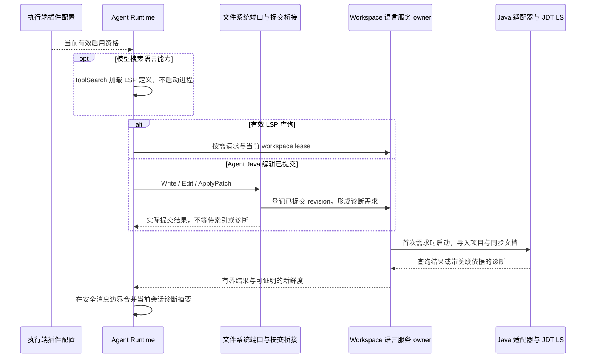

# 通用代码开发插件

状态：`implemented / verification_in_progress`，宿主原生桥接、Java 后端、对话 JDK 配置与随包资源已实现；Windows x64 核心集成通过，桌面交互验收继续进行。更新：2026-10-16。

所属专项见 [Agent 工具优化](../SPEC.md)。本文定义插件与基础工具的边界及多语言扩展方向；首个语言模块见 [Java LSP 规范](../java-lsp/SPEC.md) 和 [核心验收](../java-lsp/ACCEPTANCE.md)。已进入实施；未验收的能力仍不能标为可用。

## 1. 已确认的产品规则

| 项目      | 规则                                                                                                                 |
| --------- | -------------------------------------------------------------------------------------------------------------------- |
| 定位      | 一个通用代码开发插件，按语言和分析能力扩展；首版仅交付 Java LSP，不命名为 Java 专用插件。                            |
| 首版      | Java 导航、符号、诊断和可靠文档同步；统一面向 Agent 的 `LSP` 工具。                                                  |
| 后续      | TS/JS 后续接入；AST、Dependency Graph 保留设计待定，不是本插件首版依赖。                                             |
| 默认启用  | 默认启用；用户显式禁用后保持禁用，不因新会话、重启或工具恢复重新启用。                                               |
| 工具定义  | `LSP` 与 `JavaRuntime` 通过 ToolSearch 按需加载；通用常驻名单仍为 18 个。                                            |
| 进程启动  | 有效 LSP 查询或 Agent 的 Java 文件实际提交可触发按需启动；仅搜索、加载工具定义不启动语言服务。                       |
| Java 分发 | JDT LS 与兼容的 tooling Java runtime 随应用按平台打包，首次使用不下载启动环境。                                      |
| 项目 JDK  | 与 tooling runtime 分离；自动匹配执行环境中的候选，缺失时通过当前对话登记与保存，不增加 JDK 设置页。                 |
| 宿主接入  | 内置插件 + 宿主语言服务桥接；LSP 是插件提供的原生工具，不经过 MCP 包装。                                             |
| 禁用行为  | 当前有效作用域立即禁止新查询和新诊断任务，取消在途查询并释放该作用域 lease；不关闭其他有效作用域仍在使用的共享资源。 |
| 项目范围  | 常见 Maven/Gradle 单、多模块项目，包含 Lombok；具体兼容版本经验证锁定，其他注解处理器暂不承诺。                      |

“通用”描述产品和接口的扩展方向，不表示首版已支持所有语言、框架或项目系统。固定 Java 组合和已验证 fixture 见 [资源基线](../java-lsp/RESOURCE-BASELINE.md)；不由一个 fixture 推导所有 Java、构建工具或 Lombok 版本兼容。

补充确认（2026-10-16）：随插件增加小型 JDT 扩展，返回服务端实际分析内容的 hash 和诊断快照；与宿主当前 revision 一致才标为当前诊断。首版 Java 插件支持 Windows x64、macOS x64/ARM64、Linux x64/ARM64；Windows ARM64 明确不可用，应用其他能力保持原有平台范围。

## 2. 能力归属

| 层次           | 能力与职责                                                                                | 本轮状态                                                      |
| -------------- | ----------------------------------------------------------------------------------------- | ------------------------------------------------------------- |
| Agent 基础工具 | ToolSearch 管理发现与定义预算；Read/Write/Edit/ApplyPatch/Bash 等执行既有文件和命令操作。 | 沿用当前实现，不搬入插件。                                    |
| 插件公共能力   | 启用资格、语言路由、工具接入、工作区资源绑定与能力状态。                                  | 已实现；复用既有搜索、权限和会话系统。                        |
| Java 语言模块  | JDT LS、Java 项目导入、JDK/Build JVM 匹配、Java 诊断与语言差异。                          | 已实现，按核心验收表区分已覆盖与未覆盖场景。                  |
| 后续语言模块   | TS/JS 等语言服务适配器及其资源。                                                          | 后续扩展，不能仅注册名称就宣称可用。                          |
| 后续分析模块   | [AST](../ast/SPEC.md) 与 [Dependency Graph](../dependency-graph/SPEC.md)。                | 设计待定，保持独立能力接口，不塞进一个无限扩大的 LSP schema。 |

共享的是工作区身份、已提交文件事实与资源生命周期，不要求所有分析能力复用一个后端。标准 LSP 不提供任意 AST 或完整构建依赖图；未来模块必须核验其实际数据来源。

## 3. 安装、启用、定义加载与启动

按 [插件商店术语](../../../CONTEXT.md) 作为官方市场中的**内置插件**交付，沿用“已安装插件”的启停与卸载入口。机器 ID 为 `code-development@zcode-plugins-official`，包为 `@zcode/code-development-plugin`，版本 `0.1.0`，位于 `apps/zcode-cli/packages/code-development-plugin`。

| 阶段           | 应有行为                                                                                         |
| -------------- | ------------------------------------------------------------------------------------------------ |
| 随包分发与播种 | 带入匹配执行平台的资源和功能清单；内置插件卸载抑制状态继续有效，应用重启不能自动恢复已卸载插件。 |
| 启用           | 无显式覆盖时默认启用；只建立能力资格，不因此启动 JDT LS、导入项目或注入完整工具 schema。         |
| 发现与加载     | ToolSearch 仅搜索当前已启用、已实现且会话获准的能力；继续使用现有预算、保留与恢复规则。          |
| 实际使用       | 有效 LSP 请求，或 Agent 已提交 Java 修改产生的诊断需求，才获取语言服务资源并启动对应语言模块。   |
| 定义卸载       | 仅影响模型后续请求是否携带 schema；不禁用插件、不终止仍被使用的语言服务。                        |
| 插件禁用/卸载  | 移除对应能力资格，禁止恢复定义绕过禁用；观察有效配置变化后取消在途并释放受影响作用域资源。       |

`LSP` schema 未加载不妨碍已启用插件接收文件提交和生成自动诊断。反之，恢复过的 schema 也不能成为调用已禁用插件的凭据。受限子代理仍遵守原有效白名单和路径权限，插件默认启用不扩大其执行或读取范围。

已确认的启动触发覆盖 Write/Edit/ApplyPatch 等可确认的 Agent Java 实际提交；预检失败、未落盘项和普通读取不构成该触发。ApplyPatch 部分成功只处理已提交项。Bash、Git、外部 IDE 的变更按 Java 规范进行失效与查询前核验，不凭目录刷新事件认定是 Agent 提交或创建自主 turn。

**当前会话启停规则**：执行端配置 owner 通过目录监听和调用前刷新观察有效配置，在下一模型请求前更新工具目录，并在每次能力调用前核验资格。禁用阻止新调用与新的自动诊断工作，取消在途查询并释放受影响作用域资源；其他有效 lease 继续使用共享进程。重新启用后仍按需启动，不自动重放旧调用或历史编辑。

### 3.1 跨进程生效边界

源码确认桌面插件管理使用独立控制面 CLI，聊天 Runtime 位于另一执行进程。现有 user/workspace scope 保持不变：user 是执行环境中的低优先级配置，workspace 的显式覆盖仍优先，reset 删除覆盖后重新继承。禁止把管理请求的 `enabled` 布尔值直接当作所有工作区的最终状态。

`CodeDevelopmentPluginPolicyOwner` 异步读取有效插件配置，目录监听与调用前检查共用刷新入口。监听涵盖配置文件的原子替换和首次创建；在下一模型请求、LSP 调用和编辑触发诊断前主动核对。每个使用者根据自己的真实 workspacePath 解析配置，继续按 workspaceIdentity 隔离语言资源。

控制面保存成功只代表配置已经落盘。各执行进程观察到新有效配置后，先关闭对应作用域 admission，再取消在途与释放 lease；没有跨进程确认屏障时，不宣称 RPC 返回瞬间所有窗口已完成取消。新调用必须经过配置核对，不要求用户重启会话。该机制不把插件业务状态移入 Main、relay 或 ProtocolRuntimeResources，也不另加一条 services 广播写路径。

## 4. 已确认的宿主接入

采用**内置插件 + 宿主受控语言服务桥接**，复用现有官方插件映射宿主能力的装配方式，公共接口保持语言无关。本轮不扩展为任意第三方插件的通用代码执行宿主。

| 参与方                       | 已实现职责与边界                                                                               |
| ---------------------------- | ---------------------------------------------------------------------------------------------- |
| 插件清单与资源包             | 声明产品归属，携带语言资源及使用指引；Store Listing 只负责展示，不控制执行权限。               |
| contracts                    | `WorkspaceLanguageServicePort`、`JavaRuntimePort`、LSP/JavaRuntime 严格输入输出 schema。       |
| core                         | LSP handler、资格与路径权限、结果预算、会话诊断摘要；依赖公开 port，不直接启动 Java 或写配置。 |
| adapters                     | 持久 JSON-RPC 传输、语言适配器、文档同步与项目模型；Java 模块封装 JDT LS/JDK 规则。            |
| bootstrap / 执行端资源 owner | 根据插件资格装配 port，按 workspace 借用/释放语言服务，定位实际执行平台资源。                  |
| 文件提交桥接                 | 在文件实际提交后登记路径、变更种类和 revision，供同步与失效使用；不依赖工具最后是否返回成功。  |
| UI、Main、relay              | 沿用既有管理入口、对话与投影/路由，不拥有语言进程、JDK 配置或诊断事实。                        |

本版通过宿主原生 port 接入，不经过 MCP。当前 manifest 中的 `lspServers` 仍是 unsupported/diagnostic-only；本版不把该字段升级为通用第三方 LSP 插件执行入口。

文件提交桥接使用 `observeLanguageFileCommits` 装饰 FileSystemPort，覆盖 Write/Edit/ApplyPatch 的成功项及 rewind 的实际恢复；取消后已经落盘的修改仍同步。受限子代理的 `analyze:false` 提交可同步已存在的共享服务，但不能启动语言进程或新增诊断任务。`PostToolUse` 与可选 checkpoint 不充当提交来源，不另建事件总线。

ToolSearch 沿用现有目录、曝光状态及 32,000 token 默认预算。来源分类保持 `builtin` / `mcp`；本插件的 LSP、JavaRuntime 作为 `builtin` 原生 handler 被插件资格门控，不伪装成 MCP，不新增插件专属预算或第三种来源。

## 5. 状态所有者与事件顺序

| 事实/状态                                  | 唯一所有者                    | 生命周期                                                             |
| ------------------------------------------ | ----------------------------- | -------------------------------------------------------------------- |
| 插件安装、启用、卸载抑制                   | 既有执行端插件配置与管理链    | 持久状态；Runtime 使用当前有效资格。                                 |
| 已提交内容及 revision                      | 执行端文件系统与文件系统端口  | 分析镜像和 checkpoint 不成为另一份写入事实。                         |
| 语言进程、文档版本、诊断缓存、有效项目模型 | WorkspaceLanguageServiceOwner | 同 owner 内共享；会话持 lease，释放规则不依赖 schema 是否加载。      |
| JDK 用户登记与明确选择                     | 执行环境级 JdkStore           | 持久保存，与插件版本缓存分离；自动发现缓存和项目实际选择是派生状态。 |
| 已加载工具定义、诊断摘要展示基线           | 各会话 Runtime                | 复用 ToolExposureState；摘要基线不作为 workspace 诊断事实。          |
| 语言资源版本与校验信息                     | 产品分发清单                  | 只读资源；运行实例固定使用其启动组合。                               |

提交桥接在后续查询前登记同步需求；等待 JDT LS、项目导入和诊断不阻塞已成功的文件写入。不能在 core 依赖某个工具最终序列化或 hook 成功才登记。尚无诊断基线时反馈“当前问题”，不把首次看到的问题归因于本次编辑。无当前版本完成证据时保留 pending/stale/unknown，不用固定延时制造“检查通过”。

隔离 key 沿用 `workspaceIdentity?.trim() || workspacePath`，再区分 project root、语言服务配置与资源 owner；`workspacePath` 用于真实 I/O，远程关联保留 `remoteSessionId`。相同路径不同 identity 不共享文档缓存。一个 JDT LS `-data` 目录只由一个进程持有；手机借用已有 Host attachment，不因重连新建语言服务。

Desktop 继续 `desktop-continuous`，手机继续 `web-remote-replayable`。历史工具结果、诊断摘要与配置交互可以恢复展示，重放不重新执行编辑、保存 JDK 配置或声称历史诊断仍为当前结果。需要新增协议字段时同时更新 shared schema、V4 投影和恢复链。

## 6. 资源与配置

Java 分工、自动发现、对话保存及项目匹配完整沿用 [Java 规范第 3 节](../java-lsp/SPEC.md#3-java-运行环境分工)：tooling runtime 启动 JDT LS，Project JDK 满足项目约束，Build JVM 满足构建导入要求。不得覆盖全局 JAVA_HOME/PATH，也不静默用 tooling runtime 替代缺失项目 JDK。

对话路径默认登记为当前用户、当前执行环境的候选，跨项目和工作目录自动匹配；显式要求才固定项目。远端独立校验和保存。JdkStore 将 version 1 的 candidates/projectSelections 保存到执行端 `cliStorageRoot/code-development/jdk-config.json`，不存进随版本替换的插件目录。`JavaRuntime` 的 `list/register/select/forget` 复用真实用户输入证明与既有权限链，详见 [可信 JDK 配置](../java-lsp/TRUSTED-JDK-CONFIG.md)。已有明确保存意图不重复确认；显式 deny 仍优先，handler 最终再次验证输入证明。

资源清单须锁定 JDT LS、Java runtime 发行来源/版本、OS/arch、hash 和许可证。只读资源与可写索引/日志分开。按当前各发行渠道的目标提供资源，不把 Desktop、CLI 与 SSH 的平台支持范围视为相同；未交付的平台明确不可用，不运行时下载 `latest` 或借用本地 Java 路径。

## 7. 当前源码依据

以下是已接入的源码入口；运行验收仍按第 9 节和 Java 验收表分别记录。

| 入口                                                                                                                                                                                                                                                                                               | 已有能力与缺口                                                                       |
| -------------------------------------------------------------------------------------------------------------------------------------------------------------------------------------------------------------------------------------------------------------------------------------------------- | ------------------------------------------------------------------------------------ |
| [插件 contracts](../../../apps/zcode-cli/packages/contracts/src/plugins/index.ts)、[loader](../../../apps/zcode-cli/packages/adapters/src/plugins/index.ts)                                                                                                                                        | `lspServers` 仅声明为 `unknown`，loader 将其标为 unsupported；不能直接用它发布 LSP。 |
| [官方插件定义](../../../apps/zcode-cli/packages/bootstrap/src/app/official-plugin-definitions.ts)、[宿主装配](../../../apps/zcode-cli/packages/bootstrap/src/app/code-development-runtime.ts)                                                                                                      | 默认启用与五平台资源定位；装配语言/JDK port，按 workspace 借用与释放 owner。         |
| [插件 facade](../../../apps/zcode-cli/packages/bootstrap/src/app/plugin-facade.ts)、[有效配置 owner](../../../apps/zcode-cli/packages/adapters/src/language-service/plugin-policy.ts)                                                                                                              | 控制面保存配置；执行进程监听及主动刷新有效资格，不把保存成功伪装为跨进程取消屏障。   |
| [官方 MCP 入口](../../../apps/zcode-cli/packages/bootstrap/src/app/official-plugin-runtime.ts)                                                                                                                                                                                                     | 使用 Node server 入口重写；不能直接当成任意 Java 进程启动器。                        |
| [语言 port](../../../apps/zcode-cli/packages/contracts/src/interfaces/language-service.port.ts)、[提交桥接](../../../apps/zcode-cli/packages/core/src/runtime/helpers/language-file-commits.ts)、[同步 owner](../../../apps/zcode-cli/packages/adapters/src/language-service/workspace-service.ts) | 实际文件提交、文档版本、进程 lease 与诊断投递；不依赖 PostToolUse 或 checkpoint。    |
| [LSP handler](../../../apps/zcode-cli/packages/core/src/tool/handlers/lsp.ts)、[JavaRuntime handler](../../../apps/zcode-cli/packages/core/src/tool/handlers/java-runtime.ts)、[JdkStore](../../../apps/zcode-cli/packages/adapters/src/language-service/jdk-store.ts)                             | 插件资格、路径/工具权限、输入输出校验；JDK 配置由执行端持久保存。                    |
| [Desktop Node 资源](../../../packages/desktop/scripts/prepare-agent-node-bundle.mjs)、[SEA 资源](../../../apps/zcode-cli/packages/cli/scripts/sea-official-plugin-assets.mjs)、[资源准备](../../../apps/zcode-cli/packages/code-development-plugin/scripts/prepare-runtime.mjs)                    | 已接入目标资源准备与收集；Windows x64 staging/SEA 采集已验证，完整发行验收仍有缺口。 |
| [SSH prebuild](../../../scripts/prepare-prebuilds.mjs)、[Server stage](../../../packages/zcode-server-cli/src/packaging/stage.ts)                                                                                                                                                                  | 按目标串行准备与 staging，核对 manifest 目标；未将本机成功等同于远端实机验收。       |

## 8. 当前实施范围与后续边界

1. 已实现内置插件、宿主原生工具、有效配置刷新、共享 lease、确定性文件同步、诊断扩展与对话 JDK 配置。
2. 已验证 Windows x64 的真实 JDT 查询、Maven/Gradle 多模块与 Lombok 代表项目、CRLF 内容快照、受限 child 对既有服务的同步及核心权限边界。
3. 桌面真实模型已完成 ToolSearch→LSP 符号/当前诊断；配置交互、禁用和首次编辑等完整 E2E 状态以 [验证记录](../VERIFICATION.md) 为准，不预先标为通过。
4. 五平台资源准备不等于五平台实机运行。其他平台、更多构建/Java 版本、手机与远端恢复仍按验收缺口推进。
5. TS/JS、AST、Dependency Graph 继续保留设计待定，不作为 Java 首版交付条件。

| 边界          | 当前结论                                                                                                      |
| ------------- | ------------------------------------------------------------------------------------------------------------- |
| Java 资源     | 锁定 JDT LS 1.62.0.202610131109 / Temurin 25.0.4.1+1 / Lombok agent 1.18.48；Windows ARM64 明确不支持。       |
| 诊断关联      | 小型扩展返回实际分析内容 hash，宿主再校验当前内容与运行代次；原生无版本通知保持 unknown/stale。               |
| Java 兼容版本 | 已覆盖 Java 17 代表项目、Gradle 9.2.0、多模块及项目 Lombok 1.18.30；不承诺 Java 8–25 全版本或其他注解处理器。 |
| JDK 配置      | version 1 持久 schema 与可信输入链已实现；同版本候选无法唯一确定时由对话明确选择；未实现 VS Code 配置导入。   |

## 9. 核心验收计划

以下均为 `partial`：已有核心/集成证据，但完整用户链路仍有未覆盖项。与 Java 验收复用 fixture，不建立平台 × 语言 × 操作矩阵。

| ID     | 准备与动作                                                                  | 核心断言                                                                                                                 | 必需证据                                            |
| ------ | --------------------------------------------------------------------------- | ------------------------------------------------------------------------------------------------------------------------ | --------------------------------------------------- |
| CDP-01 | 新安装，打开普通会话，搜索并加载 LSP，再发起 Java 查询。                    | 默认启用；搜索/加载阶段无语言进程；实际查询按需启动且使用随包资源。                                                      | 启用配置、模型工具定义、进程数/路径、真实查询结果。 |
| CDP-02 | 未启动语言服务时，Agent 首次编辑 Java；再制造一次 ApplyPatch 部分成功。     | 真实提交触发诊断需求；失败/未提交项不伪造变更；写入不等待诊断，首次摘要不假称全部错误由本次修改引入。                    | 提交 revision、启动/同步顺序、工具结果、会话摘要。  |
| CDP-03 | 禁用插件并重启/恢复会话；在真实控制面与会话分离进程中禁用正在查询的作用域。 | 禁用持续有效；调用前核对当前有效配置，旧定义不授予能力；观察变更后取消在途、释放本作用域 lease，其他有效作用域不受影响。 | 持久配置版本、目录/调用资格、取消与资源释放记录。   |
| CDP-04 | 同 owner 主/子会话与手机 attachment 使用 Java；另准备同路径不同 identity。  | 原权限不扩大；语言资源按 owner 共享且跨 identity 隔离；手机重连只恢复结果，不重放写入/配置或新建进程。                   | workspace/remote 路由、lease/进程记录、V4 replay。  |

语言正确性、项目 JDK 对话配置与真实诊断验证见 [Java LSP 核心验收](../java-lsp/ACCEPTANCE.md)。实现时按目标包实际 runner 执行核心验证，临时 `.test.ts` 验证后删除。本文的链接与格式校验不等于运行时验收。

覆盖说明：CDP-01 已有真实桌面模型查询及资源采集，完整安装包断网场景未覆盖；CDP-02 已有真实 adapter 首次提交启动及 core 部分提交/取消登记，桌面完整编辑链验收中；CDP-03 已有真实配置监听、禁用 lease 与其他 lease 继续查询，控制面/会话跨进程 E2E 验收中；CDP-04 已有共享 lease、受限工具目录和跨文件提交同步，identity/手机重连/远端链路仍未完整验收。
