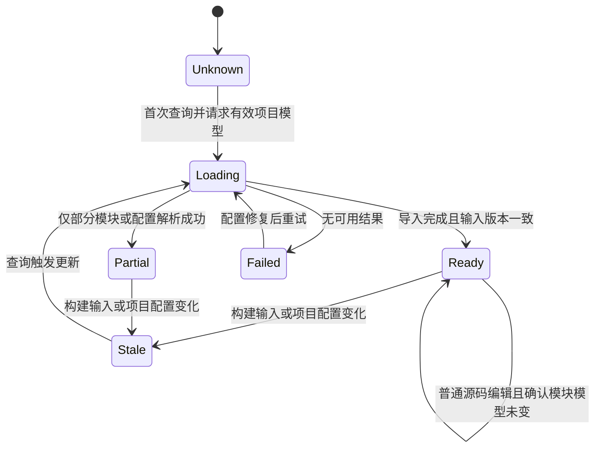

# Java 优先的 Dependency Graph 设计

当前排期：保留设计待定，待 ToolSearch 与 ApplyPatch 实现完成后再讨论软件开发插件方案及本能力实施；本轮不实现。

状态：`proposed`，仅设计，未实现、未验证。更新：2026-10-11。

本规范属于 [基础工具优化](../SPEC.md)，承接 [Java LSP](../java-lsp/SPEC.md) 的项目模型、JDK 分工与工作区隔离规则，并与 [AST](../ast/SPEC.md) 的语法/语义边界一致。用户已授权设计 AST、Dependency Graph、ApplyPatch；下文首版切分与字段均为明确提案，不代表新增运行能力或已确认全部取舍。

## 1. 行为与建议范围

建议先让 Agent 回答“当前 Java 项目有哪些模块、模块依赖谁、谁依赖它、影响沿哪条模块路径传播”，输入来自 Maven/Gradle 的有效项目模型。Java 优先，TS/JS 后续沿同一契约扩展。

- 首版建议包含本工作区已导入模块的正向、反向依赖和有证据的潜在影响路径；返回所选构建配置与覆盖范围。
- 模块依赖只表明构建模型中的依赖关系，不证明某个类、方法实际使用了另一模块，也不证明一次改动一定影响所有下游。
- 代码符号引用、调用影响与方法级增量分析建议后续结合 LSP/AST；AST 的语法关系不能直接提升为已经解析的类型或调用关系。
- 首版建议不展开第三方 artifact 的完整传递依赖图，不做 SBOM、安全漏洞分析或专用可视化 UI；这些范围尚待产品确认。
- 不承诺 Spring DI、反射、动态加载和外部消费者全覆盖；反向结果为空也不能作为“安全删除模块/符号”的结论。

## 2. 当前源码与接入证据

| 优先级         | 已核实入口                                                                                                                                                                   | 现状与关系                                                                                                                    |
| -------------- | ---------------------------------------------------------------------------------------------------------------------------------------------------------------------------- | ----------------------------------------------------------------------------------------------------------------------------- |
| evidence-only  | [dependency-graph.mjs](../../../scripts/dependency-graph.mjs)                                                                                                                | 使用 TypeScript 编译器处理 TS/JS 文件 import/export，输出 Mermaid/DOT/JSON；是仓库开发脚本，不是 Java 构建模型或 Agent 工具。 |
| evidence-only  | [dep-refs.mjs](../../../scripts/dep-refs.mjs)                                                                                                                                | 使用 ts-morph 查询 TypeScript 导出引用；静态脚本的删除建议不能成为本工具的安全性保证。                                        |
| must-inspect   | [注册入口](../../../apps/zcode-cli/packages/core/src/tool/handlers/index.ts)、[工具上下文](../../../apps/zcode-cli/packages/core/src/tool/types.ts)                          | 注册 handler 并通过 contracts port 注入能力；当前没有 Java Dependency Graph port/handler。                                    |
| must-inspect   | [模型工具投影](../../../apps/zcode-cli/packages/core/src/runtime/methods/config.ts)                                                                                          | `getTools` 提供模型定义；拟通过 ToolSearch 按需暴露，发现/加载不扩大执行权限。                                                |
| must-inspect   | [app 装配](../../../apps/zcode-cli/packages/bootstrap/src/app/create-app.ts)、[资源关闭](../../../apps/zcode-cli/packages/bootstrap/src/zcode-protocol/runtime-resources.ts) | 现有依赖注入和关闭边界；Java 项目模型与图 owner 均为待新增设计。                                                              |
| invariant-only | [workspace 装配](../../../apps/zcode-cli/packages/bootstrap/src/zcode-protocol/workspace-model-runtime.ts)                                                                   | 保留 workspacePath、workspaceIdentity、remoteSessionId，不以本机路径代替远端身份。                                            |

标准 LSP 没有通用的 Maven/Gradle 依赖图接口。候选后端为经验证的 JDT LS 扩展/项目模型接口或构建工具 adapter；具体选择、扩展协议和版本必须在实现前验证，不能把 `workspace/symbol` 当作模块图来源。

## 3. 图的范围、节点、边与依据

图是某个工作区、构建根集合和构建配置的快照，而不是“整个仓库永久完整的依赖事实”。所有查询回显 `graphScope`：`workspaceKey`、`buildRoots`、`buildSystem`、`configuration`、`modelRevision`、`snapshotId`。

`workspaceKey` 使用 `workspaceIdentity?.trim() || workspacePath`；`buildRoots` 是执行端 URI。`configuration` 记录影响模型的 Maven profiles/依赖作用域，或 Gradle configuration/variant，以及实际 JDK/toolchain 选择来源。不同配置结果不得无标记合并。

| 对象        | 拟议字段与语义                                                                                                                                                                     |
| ----------- | ---------------------------------------------------------------------------------------------------------------------------------------------------------------------------------- |
| module node | `id`、`kind: module`、`name`、`buildRootUri`、`modulePath`、可用时的 `coordinates`、`sourceRoots`、`modelRevision`；ID 由 build owner 的组件身份生成，不仅使用 artifactId/目录名。 |
| module edge | `id`、`from`、`to`、`kind: moduleDependency`、`configuration`、`provenance`；方向固定为“依赖方 → 被依赖方”。正反向查询共用同一条事实。                                             |
| provenance  | `provider`、`providerVersion`、`modelRevision`、`resolvedComponentId`，以及确实可定位时的声明 URI/范围；无法定位行号时保留模型来源，不编造声明位置。                               |
| coverage    | `includedModules`、`missingModules`、`excludedConfigurations`、`unresolvedDependencies`、`reasons`；说明哪些边界没有进入图。                                                       |
| impact path | `changedModuleId`、`dependentModuleId`、有序 `edgeIds`、路径方向说明与 `potential: true`；路径必须逐边引用同一快照中的证据。                                                       |

Maven parent、聚合模块列表和 `dependencyManagement` 不自动产生模块依赖边；Gradle project inclusion 也不自动等同于 configuration 中的 project dependency。必须使用有效且已解析的项目关系。

第三方 artifact 不伪装成本地 module。建议首版仅在覆盖说明中记录模块边界外的直接 artifact 摘要（坐标、配置、解析状态），不参与模块反向遍历；该摘要也不宣称为完整第三方清单。仅坐标相同不足以认定本地模块替代了仓库 artifact，须有实际解析组件的依据。

构建 profile、variant 或生成逻辑未覆盖时返回 `partial`/`unknown` 及原因。源码所属模块依据导入模型的 source roots，而不是仅按最近的 `pom.xml` 或目录前缀猜测。

## 4. 拟议工具操作

建议提供 `DependencyGraph` 工具，参数和运行时校验集中定义于 contracts；以下名称为设计提案。workspace/remote 身份由 runtime 注入，模型不能通过参数选择另一 owner。

| operation      | 输入提案                                                         | 输出                                                              |
| -------------- | ---------------------------------------------------------------- | ----------------------------------------------------------------- |
| `modules`      | `buildRoot?`、`configuration?`、`limit?`                         | 模块节点、图范围、覆盖与状态；多构建根/配置有歧义时返回可选范围。 |
| `dependencies` | `moduleId`、`configuration?`、`depth?`、`limit?`                 | 有界正向模块依赖、边证据；默认深度 1。                            |
| `dependents`   | `moduleId`、`configuration?`、`depth?`、`limit?`                 | 有界反向模块依赖；默认深度 1，空结果附覆盖边界。                  |
| `impactPaths`  | `moduleIds` 或 `filePaths`、`configuration?`、`depth?`、`limit?` | 受影响候选模块及反向可达的解释路径；文件先按当前模型映射到模块。  |

通用输出包括 `graphScope`、`status`、`freshness`、`coverage`、`nodes`、`edges`、`truncated` 和 `reasons`。结果按稳定 ID 排序并受预算限制；截断后不能声称已返回全部下游或全部路径，不默认将整图注入模型上下文。

状态与新鲜度分开：`status = ready | loading | partial | unsupported | failed`；`freshness = current | stale | unknown`。`ready/current` 只对应声明范围；缺失模块、导入失败与不支持的配置不能输出成“成功且零依赖”。

深度和结果上限由实现时的预算确定；若采用分页，游标须绑定 `snapshotId`，图已更新时要求重查，不能拼接不同快照。环通过访问集合与有界遍历处理，不能靠递归次数偶然停止，也不把环隐藏为缺失边。

## 5. 状态所有者与接口

| 状态/职责                               | 拟议唯一所有者                                        | 其他参与方                                                                  |
| --------------------------------------- | ----------------------------------------------------- | --------------------------------------------------------------------------- |
| 有效 Java 项目模型、构建配置与 JDK 解析 | 执行端 workspace 项目模型 owner，与 Java LSP 导入共享 | LSP 与图 adapter 消费同一模型版本，不各自持有互相矛盾的导入事实。           |
| 模块图、反向索引、source-root 映射      | workspace 图 owner                                    | 由模型版本派生；不保存任务队列或充当会话事实源。                            |
| 查询资格、路径权限、结果预算            | Agent Runtime / handler                               | 经拟议 `DependencyGraphPort` 查询；不直接启动 Maven/Gradle 或访问索引文件。 |
| 进程、文件/网络 I/O、构建模型提取       | adapter，经 bootstrap 装配                            | 使用异步 I/O；所需执行、下载和项目导入副作用遵守现有执行策略。              |
| 工具结果和历史展示                      | 会话事件/投影链                                       | UI 只消费投影，Main/relay 只做既有路由，不持有图。                          |

图 owner 的隔离范围包含执行端、workspace key、build roots 与 configuration；主会话和子代理借用同一有效快照，ToolSearch 卸载定义不会销毁图。复用 LSP 模型不允许绕过会话允许的目录范围而返回其他模块内容。

持久化建议仅保存可丢弃的版本化缓存；加载缓存时校验模型输入指纹、后端版本与配置，校验不了就标记 stale/unknown。原始构建文件、有效导入模型和缓存是不同事实层，历史工具结果仍是历史快照。

## 6. 构建、失效和查询顺序

构建 owner 先完成有效模型导入，图 owner 再按 `modelRevision` 生成不可变快照，随后查询该快照。构建中发生输入变化时，旧任务的完成结果不能覆盖新代次；没有完成/一致性证据时返回 loading、stale 或 unknown，不用固定 sleep 声称最新。

- `pom.xml`、父模型、profiles/settings、Gradle settings/build scripts、版本目录、toolchain/JDK 配置及模型实际读取的输入变化，使相关模型与图失效；外部依赖解析变化也须反映在模型代次中。
- 普通方法体编辑不必重建模块依赖图；文件移动/新增/删除使文件到模块映射和对应源码 revision 失效。构建逻辑读取源码或不能确定输入影响时，先失效或标记 unknown，不能假定拓扑未变。
- Agent 写入、Bash、Git、外部 IDE 变更通过执行端变更链更新输入代次；查询前核对所用模型及目标文件映射，不能仅比较查询文件 mtime 就保证整图最新。
- 图异常不改变已经提交的文件写入结果。项目 JDK 缺失、构建导入受阻等沿用 Java LSP 的可观察状态及对话配置流程，不另增设置入口或保存一套 JDK 配置。配置提交后，项目 owner 重新匹配，实际模型输入改变才使相关图失效；不下载项目 JDK，也不静默改用 tooling runtime。

## 7. 用户界面和远端边界

Desktop/CLI 使用现有工具调用与结果展示；建议首版不增加图编辑器或后台通知。查询结果支持 Agent 按路径解释影响，不据此自动修改、删除或发起测试/编译构建；获取有效模型可能触发项目导入与依赖解析，复用前述受控 adapter 流程，不将其伪装成无副作用的缓存读取。

Desktop 继续 `desktop-continuous`；手机 `web-remote-replayable` 恢复同一工具结果快照，不重新创建导入进程。远端图由远端执行端持有，并贯穿 `remoteSessionId` 路由；手机 attachment 断开不销毁仍由原 owner 使用的图。

若新增状态事件/结果 metadata，需更新 shared schema 和恢复投影；恢复展示必须保留原 `snapshotId` 与新鲜度，不能把重放时间当作重新检查时间。实际 owner 关闭才释放自有资源，不改变既有 session admission 或 owner/lease。

## 8. 代表性验收提案

以下均为 `planned`，待首版范围确认后实现；不代表现有覆盖。

| ID    | 准备                                                                                       | 动作                                                       | 核心断言                                                                 | 必需证据                                   |
| ----- | ------------------------------------------------------------------------------------------ | ---------------------------------------------------------- | ------------------------------------------------------------------------ | ------------------------------------------ |
| DG-01 | 一个含 parent/聚合关系的 Maven 多模块 fixture，一个含 project dependency 的 Gradle fixture | 导入后查询模块、正反向边和影响路径                         | 边来自有效配置；聚合不冒充依赖；路径逐边可追溯，第三方坐标不冒充本地组件 | 有效模型、选用配置、snapshot 与 provenance |
| DG-02 | 已有图及文件到模块映射                                                                     | 修改构建依赖后查询，再移动源码文件；让旧导入晚于新导入完成 | 图与映射按对应输入失效，旧完成不覆盖新快照；普通方法体修改不无条件重导入 | 输入代次、模型完成事件、查询结果           |
| DG-03 | 一个模块缺失 JDK/导入失败，另一个反向依赖为空，查询结果受上限截断                          | 查询反向依赖和影响路径                                     | partial/unknown、零结果、截断分别可见；不输出“安全删除”或完整影响证明    | coverage、状态、边证据与模型失败来源       |
| DG-04 | 相同路径不同 identity；同 owner 主/子会话与手机 attachment                                 | 并发查询，再断开重连手机并关闭 owner                       | 隔离正确、同快照复用、重放不伪造新鲜度、关闭后资源归属清楚               | workspace/remote 路由、工具事件与资源记录  |

验证入口以实现时的 package scripts 为准。当前 core/adapters 仅核实已有 typecheck/lint，无统一 `test` script，也无本能力 Java fixture；不虚构 `test:dependency-graph`。实现阶段再选择最小可用 runner，真实模型集成验证不能仅由模拟图单测替代。

## 9. 待确认与图索引缺口

需确认建议首版范围、支持的 Maven/Gradle 项目类型和配置选择入口；需验证项目模型提取后端、复合构建/多根解析边界及模型失效证据，不能据标准 LSP 推断这些能力已存在。

`graph-drift-candidate`：现有种子覆盖工具注册、模型工具投影和 app 资源关闭，但没有 Java 项目模型/模块图实现节点。本轮只报告；待源码落地后再补实际 owner、port 和模型派生边，不将拟议名称登记为当前能力。
