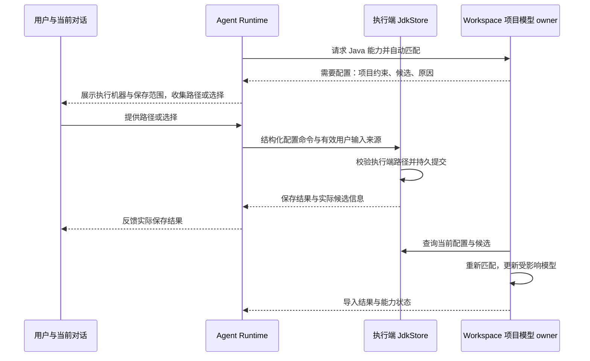
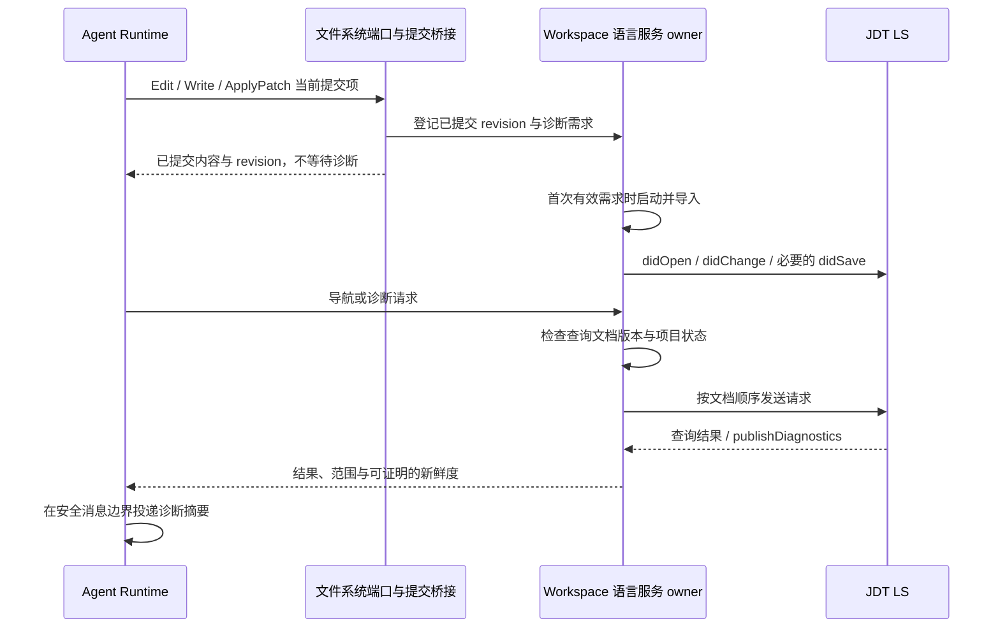

# 通用代码开发插件：Java LSP 规范

状态：`implemented / verification_in_progress`，Java LSP、诊断内容快照、确定性同步、对话 JDK 配置及五平台资源准备已实现；核心集成通过，桌面与跨平台验收仍有未覆盖项。更新：2026-10-16。

当前排期：作为通用代码开发插件首个语言模块推进；采用宿主原生桥接，支持常见 Maven/Gradle 单、多模块及 Lombok，具体兼容版本经真实验证锁定。AST、Dependency Graph 不作为本模块交付前提。

本文属于 [Agent 工具优化专项](../SPEC.md)，插件归属、启用与通用宿主边界见 [通用代码开发插件规范](../code-development-plugin/SPEC.md)，Java 验收见 [ACCEPTANCE.md](ACCEPTANCE.md)。工具发现与模型加载见 [ToolSearch 规范](../tool-search/SPEC.md)，发布组合核验见 [资源与协议基线](RESOURCE-BASELINE.md)。

## 1. 已确认的产品决策

| 项目          | 决策                                                                                                                    |
| ------------- | ----------------------------------------------------------------------------------------------------------------------- |
| 插件归属      | 通用代码开发插件的首个语言模块；不独立定义 Java 专用插件，不搬迁 Agent 基础工具。                                       |
| 启用与启动    | 插件默认启用、禁用后保持禁用；有效 LSP 查询或 Agent Java 实际提交按需启动，搜索/加载定义不启动。                        |
| 语言顺序      | Java 首先交付；TS/JS 及其他语言后续接入，不作为 Java 首版发布前提。                                                     |
| 首版能力      | 导航、符号、诊断，以及可靠的文档同步。                                                                                  |
| 启动环境      | 产品管理 JDT LS 及兼容 Java 运行环境，随应用按平台打包，安装后即可启动语言服务。                                        |
| 项目 JDK      | 按项目配置匹配执行环境中的 JDK；与语言服务启动运行环境独立。                                                            |
| 配置交互      | 自动发现与匹配；缺失或冲突时在当前对话中处理并保存配置，不新增 JDK 设置页或要求逐工作目录设置。                         |
| 默认保存范围  | 对话提供的 JDK 路径默认登记为当前执行环境的候选；各项目和工作目录自动匹配。仅用户明确要求时固定项目选择；远端独立保存。 |
| 项目 JDK 缺失 | 明确报告缺失及配置方式，由用户安装或配置路径；首版不自动安装项目 JDK。                                                  |
| 诊断反馈      | 支持主动查询；Agent 编辑后自动反馈新增诊断摘要。                                                                        |
| 项目范围      | 常见 Maven/Gradle 单、多模块及 Lombok；其他注解处理器暂不承诺，具体兼容版本经真实验证锁定。                             |

首版不包含重命名、code action、格式化、任意 server command、调试器或完整 Java 构建工具管理。后续写入类能力必须另行接入权限、文件版本冲突及 checkpoint/rewind，不能直接执行服务器返回的 `WorkspaceEdit`。

“安装后即可使用”指 JDT LS 与启动环境无需首次联网下载。项目 JDK、Maven/Gradle 依赖或构建工具缺失，仍需如实报告；不能将随包语言服务解释为任意项目均可离线完整分析。

## 2. 当前源码与改动边界

| 已核实入口                                                                                                                                                                                                                                              | 当前能力与接入影响                                                              |
| ------------------------------------------------------------------------------------------------------------------------------------------------------------------------------------------------------------------------------------------------------- | ------------------------------------------------------------------------------- |
| [LSP handler](../../../apps/zcode-cli/packages/core/src/tool/handlers/lsp.ts)、[JavaRuntime handler](../../../apps/zcode-cli/packages/core/src/tool/handlers/java-runtime.ts)、[注册](../../../apps/zcode-cli/packages/core/src/tool/handlers/index.ts) | 已注册可执行原生工具，受插件资格及会话工具范围控制，通过 ToolSearch 按需加载。  |
| [语言 port](../../../apps/zcode-cli/packages/contracts/src/interfaces/language-service.port.ts)、[Runtime deps](../../../apps/zcode-cli/packages/core/src/runtime/types.ts)                                                                             | contracts port 注入语言/JDK 能力，core 不直接管理进程与配置存储。               |
| [FileSystemPort](../../../apps/zcode-cli/packages/contracts/src/interfaces/file-system.port.ts)、[提交桥接](../../../apps/zcode-cli/packages/core/src/runtime/helpers/language-file-commits.ts)                                                         | 真实写盘/删除后登记同步；保留换行的读取供语言快照使用，不改变普通读取默认值。   |
| [ExecutionPort](../../../apps/zcode-cli/packages/contracts/src/interfaces/execution.port.ts)                                                                                                                                                            | 不具备 LSP 所需的持久双向 JSON-RPC 传输，不能把一次命令执行当成语言服务客户端。 |
| [文件监控](../../../packages/services/src/fileWatcher/fileWatcherService.ts)                                                                                                                                                                            | 为 UI/Git 提供合并后的目录刷新，不能证明具体文档版本已同步。                    |
| [宿主装配](../../../apps/zcode-cli/packages/bootstrap/src/app/code-development-runtime.ts)、[workspace owner](../../../apps/zcode-cli/packages/adapters/src/language-service/workspace-service.ts)                                                      | 注入 adapter、共享与释放 lease；资源不可用降级为插件失败，不阻断普通会话。      |
| [资源准备](../../../apps/zcode-cli/packages/code-development-plugin/scripts/prepare-runtime.mjs)、[资源清单](../../../apps/zcode-cli/packages/code-development-plugin/resources.json)                                                                   | 固定 JDT/JDK/Lombok 与诊断扩展，按目标进入 Desktop/SEA/SSH/Server 分发。        |

本次涉及能力配置、进程生命周期、文档同步、诊断投影和恢复，不涉及会话 admission、任务队列或 owner/lease 的重新设计。

## 3. Java 运行环境分工

| 角色            | 所有者与来源                                        | 用途                                                               |
| --------------- | --------------------------------------------------- | ------------------------------------------------------------------ |
| Tooling runtime | 产品随包、固定版本与平台的 Java 运行环境            | 仅用于启动 JDT LS；版本跟随经过验证的 server/runtime 组合。        |
| Project JDK     | 执行端发现及用户登记的安装目录 + 项目模型/toolchain | 提供项目所需 Java API、编译环境及语言级别信息，可按项目/模块不同。 |
| Build JVM       | 项目构建工具配置解析                                | 用于 Gradle daemon 等构建导入进程；与编译 toolchain 可能不同。     |

参考 VS Code Java 的 embedded tooling runtime 与 `java.configuration.runtimes` 分离方式，但不复制其所有历史 fallback。受管启动环境不得覆盖全局 `JAVA_HOME`、`PATH` 或现有 Bash 会话环境，也不得静默充当缺失的项目 JDK。

### 3.1 随包资源

- 资源清单锁定 JDT LS 发布版本、兼容 Java runtime 版本/发行来源、目标 OS/arch、内容校验值及许可证清单；禁止运行时解析 `latest`。
- Windows、macOS、Linux 按产品现有发布目标准备资源。运行时按实际执行端平台解析绝对可执行路径，不拼装跨平台 shell 启动命令。
- 安装产物中的 server/runtime 为共享只读资源；可写配置、日志和 JDT LS `-data` 位于产品数据目录，不写应用安装目录。
- 新应用版本提供新组合；已经运行的服务固定使用创建时的组合，关闭后才启用新组合。无独立后台自动更新器。
- 桌面、独立 CLI 发行物均需有明确资源定位规则；远端部署携带与目标平台匹配的资源包。远端尚无资源时报告部署未完成，不借用桌面的 Java 路径。
- 复用现有资源清单、校验与安装机制的公开边界；core 不得跨层导入 server-cli 或 Desktop 的资源安装实现。

锁定组合为 JDT LS 1.62.0.202610131109、Temurin 25.0.4.1+1、Lombok agent 1.18.48 与同包诊断扩展。该 JDT LS tag 的 README/core manifest 虽仍列 Java 21，必要 bundle 实际要求 JavaSE 25。支持准备 Windows x64、macOS x64/ARM64、Linux x64/ARM64 资源，Windows ARM64 输出明确 unsupported manifest；不下载替代 JVM。当前实机验证为 Windows x64，其他平台不能据资源存在就标为运行通过。构建、hash 和许可证规则见 [资源基线](RESOURCE-BASELINE.md)。

### 3.2 项目 JDK 解析

解析分为“项目要求什么”和“执行端有哪些安装”两个阶段：

1. 在实际执行端自动发现已安装 JDK，并合并用户通过对话登记的路径；校验实际版本、架构和可访问性，记录候选来源。自动发现与匹配是正常路径，不要求用户先登记每个工作目录；候选清单本身不等于项目选择。
2. Maven/Gradle 项目以导入后的有效项目模型和 toolchain 为依据，包括父 POM、profiles、模块和构建设置；不靠正则解析构建脚本重新实现项目系统。
3. 将项目的执行环境/toolchain 要求映射到候选 JDK；显式绑定也必须满足项目约束。不同模块可以选用不同 JDK，不强制一个 workspace 只有一个项目 JDK。
4. `source`、`target`、`release` 表示语言/API/输出目标，不能直接等同于“必须使用同版本 JDK”。保留项目约束、实际选择、兼容性依据和配置来源。
5. 非 Maven/Gradle 的独立文件优先使用已有、经对话明确选择的默认项目 JDK；尚无默认且不能唯一确定时在当前对话选择，不静默采用最新 JDK。
6. 缺失、不兼容或候选存在无法消解的歧义时，返回所需版本/约束、涉及构建项目、候选及原因，由当前对话收集路径或选择。已可用的项目可继续查询；受影响项目不得把缺失导致的空结果视为分析成功。

Gradle daemon JVM 的选择单独遵守构建版本和配置约束；toolchain 选择不改写 daemon JVM。Maven 导入器采用的运行时也应可观察，不能因 JDT LS 启动成功就声称构建环境兼容。

工作目录不是配置单位。同一构建项目的子目录复用其解析规则；多个 worktree 可以复用执行端候选清单，但必须重新核对各分支的构建约束。一个 workspace 内存在多个构建根时分别解析，不能将其中一个项目的选择强制应用到所有构建根。

执行端候选、项目模型要求和非托管项目默认值分别处理。JdkStore 发现来源包含已登记路径、当前明确选择、JAVA_HOME、PATH 与常见安装根；真实执行 Java 并核验 release 信息。按 major 分组后优先明确选择、其次唯一候选；仍有歧义时通过当前对话处理，不静默选最新版本。已实现 version 1 配置及存储接入，未实现 `.vscode/settings.json` 导入，也不要求用户手工编辑配置文件。

### 3.3 对话配置与保存

正常匹配成功直接继续任务；需要人工处理时，在当前对话说明执行机器、构建项目、所需 JDK 和发现结果，再复用 `AskUserQuestion` 的选择与自定义文本收集路径。用户也可以主动在对话中要求查看、登记、更换或移除已保存的 JDK 配置。已有明确路径和保存范围时直接校验并提交，不再增加一次重复确认。

**已确认的保存范围**：对话提供的 JDK 路径经校验后，默认持久登记为当前用户、当前执行环境的可用候选。同一执行环境的所有项目、工作目录和 worktree 复用候选清单，并按各自当前构建约束自动匹配；只有用户明确要求时才固定某个项目的选择。远程机器在各自执行环境保存与校验，不继承桌面的安装路径。

登记候选不设置统一的项目 JDK，不改写 Maven/Gradle 配置，也不自动设置非托管项目的默认值。例如记住一个 JDK 17 路径后，需要它的项目可以自动匹配，要求 JDK 21 的其他项目仍按自己的约束解析。新会话和应用重启后继续复用登记，无需逐工作目录重新填写。

保存过程分为用户意图、路径校验和持久提交：

1. 对话展示本次操作及生效范围；提问答案和普通用户消息仅提供输入，不能成为配置存储。
2. Agent 通过按需工具 `JavaRuntime` 和受类型校验的 `JavaRuntimePort` 交给执行端 JdkStore；在实际执行机器上校验安装路径及版本，项目兼容性由有效模型另行核对。缺失时保留问题状态，由用户安装或提供新路径。
3. JdkStore 持久更新相关记录后返回保存结果；失败时反馈未保存。仅在持久提交成功后回复“已记住”，包含实际版本、路径和生效范围。
4. 依赖该配置的项目重新匹配；实际选择改变时使项目模型及诊断失效并重试导入。仅添加一个无关候选不要求重启全部语言服务；保存成功与项目导入成功分别反馈。
5. 新会话和重启后从执行端存储恢复用户配置，再校验当前路径和构建约束。历史对话、压缩摘要或恢复的提问结果不重新执行配置写入。

取消、跳过、空答案、超时自动结束不会修改持久配置；受影响能力继续报告需要配置，其他工作可继续。`TurnUserIntentEvidence` 保留当前用户消息与真实提交答案对应的操作/路径/范围，模型、hook 与历史恢复文本不能伪造保存意图。`prepareApproval` 对已有明确意图取消重复确认，显式 deny 仍优先，handler 执行前再次验证证明；缺少证明返回 needs_user_input。详见 [可信 JDK 配置](TRUSTED-JDK-CONFIG.md)，不使用模型填写的 confirmed 布尔值。

不能直接提问的 headless 子代理将缺失状态交回父会话处理，不能自行等待或选择默认 JDK。父子会话复用同一配置结果，避免同一个缺失问题在多个子任务重复提问。无交互入口的 CLI `-p` 返回需要配置及修复说明，不挂起等待回答。

### 3.4 当前配置入口与存储

| 已核实入口                                                                                                                                                                          | 现有事实与接入边界                                                                                                          |
| ----------------------------------------------------------------------------------------------------------------------------------------------------------------------------------- | --------------------------------------------------------------------------------------------------------------------------- |
| [配置装配](../../../apps/zcode-cli/packages/adapters/src/config/config-factory.ts)、[JdkStore](../../../apps/zcode-cli/packages/adapters/src/language-service/jdk-store.ts)         | 普通配置继续合并现有来源；JDK version 1 配置由独立 JdkStore 持久保存，不误用仅改 Session 内存的 ConfigPort.set。            |
| [app 装配](../../../apps/zcode-cli/packages/bootstrap/src/app/create-app.ts)、[工作区信任存储](../../../apps/zcode-cli/packages/adapters/src/storage/workspace-hook-trust-store.ts) | 已有依据用户配置定位数据目录、由 adapter 串行持久写入的实现模式。JDK 配置新增独立 owner，复用公开存储机制，不写进信任记录。 |
| [提问 contract](../../../apps/zcode-cli/packages/contracts/src/tools/ask-user-question.ts)、[可信输入](../../../apps/zcode-cli/packages/core/src/runtime/user-intent-evidence.ts)   | 服务端保存真实回答来源；空答案、模型/hook 文本或重放历史不构成配置提交证明。                                                |
| [对话交互](../../../packages/ui/src/v4/V4InteractionDialogs.tsx)、[回答解析](../../../packages/ui/src/lib/askUserQuestion.ts)                                                       | 复用现有对话提问和路径文本输入，不新增设置页、独立配置面板或要求用户复制配置 JSON。                                         |

`JavaRuntime` 提供 `list/register/select/forget`；select 可区分项目 JDK 与 Build JVM，forget 只移除登记，不删除安装文件。core 只调用配置 port，保存由执行端 owner 完成。工具具备配置副作用，按既有权限和 ToolSearch 目录管理，不增加常驻工具。

用户明确登记的 candidates 与 projectSelections 持久保存到执行端 `cliStorageRoot/code-development/jdk-config.json`（schema version 1）；自动发现可重建，项目实际 VM 由导入模型查询。写入串行更新并保留其他记录，多个会话不能各自覆盖整份文件；配置不跟随插件版本目录替换。

## 4. 工具与架构接口

插件对 Agent 暴露通用 `LSP` 查询工具和独立 `JavaRuntime` 配置工具。语言路由由文件与工作区能力决定，不新增 JavaLSP 平行查询工具。公共查询 port 保持语言无关，JDT/JDK 细节留在适配器。第三方 manifest 的 `lspServers` 仍不执行。

`LSP` 按 ToolSearch 首版名单作为按需加载工具。加载/卸载只影响模型请求是否携带其定义，不授予执行权限，也不代替语言服务 owner 的启动、同步、诊断与释放规则。

| operation                                      | 输入           | 结果                       |
| ---------------------------------------------- | -------------- | -------------------------- |
| `definition` / `references` / `implementation` | 文件路径、行列 | 有界的定义、引用或实现位置 |
| `hover`                                        | 文件路径、行列 | 类型、签名、文档摘要       |
| `documentSymbols`                              | 文件路径       | 文件符号与范围             |
| `workspaceSymbols`                             | 查询词         | 工作区符号与位置           |
| `diagnostics`                                  | 可选文件路径   | 文件快照或有界工作区扫描   |

接口已集中定义于 [LspInputSchema/LspOutputSchema](../../../apps/zcode-cli/packages/contracts/src/tools/lsp.ts)。输入 limit 默认 50、最大 100；工作区诊断最多扫描 50 个 Java 文件并明确保持工作区索引新鲜度 unknown，不等于全项目检查。调用层级、类型层级后续再扩展；服务器未声明的操作返回 unsupported。

结果明确 file/workspace 范围、truncated、status 和 freshness，文件查询附可用的 revision、文档版本及内容 hash。Agent 行列为 1-based UTF-16，adapter 转换为 LSP 的 0-based UTF-16。导航和符号不能证明整个索引最新时保持 unknown；文件诊断只有内容快照确证后为 current。

当前层次：

- `contracts`：`WorkspaceLanguageServicePort`、`JavaRuntimePort` 与严格运行时输入输出校验。
- `core`：LSP handler、工具权限、输出预算与会话诊断摘要；不直接持有 `child_process` 或读写配置。确定性同步使用文件实际提交桥接，不依赖 PostToolUse。
- `adapters`：长期 stdio/JSON-RPC 连接、server capability 协商、文档同步、项目导入与语言服务资源管理。
- `bootstrap`：注入服务、运行环境路径和配置，绑定 workspace 资源生命周期；会话仅持有借用句柄。
- UI：复用会话消息和提问组件收集答案，通过现有服务 hooks 提交；不新增 JDK 设置入口，不直接写配置或操作语言服务进程。

导航/诊断是代码只读能力，仍遵守现有读取路径和会话工具限制；启动、项目导入、缓存写入与依赖解析的副作用单独通过 adapter 和现有执行策略管理。首版不自动接受 `workspace/applyEdit`。

## 5. 状态所有者与持久化

| 状态                        | 唯一所有者                   | 生命周期/持久化                                        |
| --------------------------- | ---------------------------- | ------------------------------------------------------ |
| 随包资源版本与位置          | 产品资源装配层               | 应用发布清单；不由会话修改                             |
| JDK 自动发现结果            | 执行端 JDK 发现服务          | 可重建候选缓存；不是项目实际选择                       |
| JDK 登记与明确选择          | 执行端 JdkStore              | 持久配置；本地与远端各自保存，不能仅存于会话           |
| JDK 对话输入与显示          | 既有会话交互链；UI 持有草稿  | 仅提交意图与投影结果，不持有配置事实                   |
| 项目 JDK 选择               | 语言服务管理器的有效项目模型 | 派生状态，随构建配置/JDK 配置变更失效                  |
| JDT LS 进程、连接和索引目录 | workspace 语言服务 owner     | 同一 owner 内共享；最后使用者释放/owner 关闭时回收     |
| 文件内容                    | 文件系统的已提交内容         | 文档镜像不能成为第二个写入事实源                       |
| 文档镜像、版本、诊断缓存    | 语言服务管理器               | 可重建缓存；重启后重新同步，历史诊断不自动变为当前诊断 |
| 诊断摘要投递                | 会话 Runtime                 | 进入现有会话事件/消息链；UI 仅投影                     |

隔离 key 保持 `workspaceIdentity?.trim() || workspacePath`，再区分 project root、server/config 组合及必要的资源 owner。`workspacePath` 用于执行和文件展示，远程关联保留 `remoteSessionId`。相同路径但不同 identity 的工作区不能共用文档镜像。

执行端候选可在同一用户与执行环境中复用；这不允许跨 workspace 合并项目模型、文档或诊断。远端 JDK 路径在远端校验与保存，对话明确显示当前执行机器；不能把桌面路径复制为远端配置。

一个 `-data` 目录只能由一个 JDT LS 进程持有。同一执行端 owner 内主会话和子代理共享服务；跨 owner 不能仅凭目录相同就共享可写索引。手机 attachment 断开不应销毁桌面仍在使用的服务；实际 owner 关闭时完成 shutdown/exit 和进程回收。

## 6. 启动与文档同步

插件有效启用且需求在会话获准范围内时，首次有效 LSP 查询或 Agent Java 文件实际提交产生的诊断需求解析随包资源、建立语言服务、完成初始化并导入项目。搜索/加载工具定义本身不启动；未加载 LSP schema 不阻止编辑后的自动诊断。区分 `starting`、`importing`、`ready`、`failed`；项目缺少 JDK/依赖时保留具体问题。初始化完成不等于项目索引完成。

- 对同一文档串行发送版本变更；`didChange` 是通知，没有通用“服务端已诊断完成”应答，不能把发送成功当作最新诊断已经产生。
- Edit/Write 的成功落盘及 [ApplyPatch](../apply-patch/SPEC.md) 的实际已提交项是确定性同步入口；rewind 的实际文件恢复也同步。登记不依赖 PostToolUse 或可选 artifact/checkpoint 生成成功，取消后已落盘项、补丁部分失败的成功项不能漏掉。LSP 失败不能把已成功写入伪报为失败或重复写入。
- 语言服务使用 FileSystemPort 的 `preserveLineEndings` 读取选项，并核对 `lineEndingsPreserved`，保留实际 LF/CRLF 内容计算 hash 和发送文档；普通 Agent 读取继续沿用既有默认行为。编码解码沿用文件系统端口，不引入 UTF-8-only 文件限制。提交中的 LF 文本只提供变更事实，诊断前以实际文件内容为准，防止 JDT didSave 重载磁盘后 hash 不一致。
- 受限子代理或已禁用 lease 的已落盘事实仍可用 `analyze:false` 同步已有共享服务；该路径不创建新语言进程、不新增自动诊断工作，也不扩张子代理工具权限。
- Bash、Git、生成器和外部 IDE 变更通过执行端 watcher 标记失效；查询前检查目标文档当前 revision，避免已打开的 LSP buffer 长期覆盖磁盘事实。
- 依赖文件、构建文件的变化也会影响结果：通知服务器并使相关项目索引/诊断失效，不能只比较查询文件的 mtime 后声称全项目最新。
- 新建、删除、重命名及文件重新出现更新 URI 和打开文档状态；不把旧 URI 的诊断带到新文件。
- 文档版本单调递增；旧 server 实例或旧同步版本返回的结果不得覆盖新结果。版本等待依据协议/服务器状态，不用固定 sleep 掩盖时序问题。

## 7. 诊断查询与自动反馈

查询屏障还覆盖外部编辑：发出实际 LSP 查询前重新核对当前 server 已打开的文档集合并同步磁盘内容，删除/恢复也保留跟踪资格。`didChangeWatchedFiles` 不能替代这一步，因为 JDT 对已打开的 working copy 不会仅凭文件通知重新装载内容。此校验只覆盖已打开集合，不扫描整个工作区，也不依赖 watcher 抢先到达或固定等待时间。

主动 `LSP diagnostics` 返回当前可用结果，并区分未就绪、过期、当前以及失败。没有收到通知与收到当前版本空诊断是不同状态；文件级检查不等于整个项目通过。

自动反馈遵循：

1. 插件有效启用时，Agent 文件修改提交后，将获准范围内受影响的 Java 文档加入当前会话的待诊断集合；语言服务尚未启动则按需启动，不要求先调用 LSP。外部修改只使缓存失效，不自行制造无限轮次的 Agent 输入；插件禁用后不启动新的自动诊断工作。
2. 获取与当前文件/项目状态相符的诊断后，与同一会话最近已展示的有效快照比较，反馈新增/加重的问题及必要的已解决数量。首次没有有效基线时标记为当前问题，不能声称全部由本次编辑引入；截断结果不替换完整基线，也不能据遗漏项计算“已解决”。
3. 身份建议由项目、URI、诊断来源/代码、范围和消息组成；去重只用于减少展示，不改变诊断事实。编辑引起位置移动时不得作无依据的因果判断。
4. 在当前工具批次结束或下一模型步骤等安全边界合并投递一条有界摘要，附文件、位置、严重性与主动查询入口。完整列表仍可查询，不反复向上下文塞入全项目诊断。
5. 若仍在导入或无法证明诊断属于当前版本，返回 pending/stale 状态，不能阻塞正常文件写入，也不能输出“检查通过”。诊断完成不默认触发新的自主 turn。
6. 服务端诊断不携带版本时，必须依据锁定 JDT LS 版本可验证的诊断/项目任务完成机制建立关联；如果无法建立关联，保留 unknown/stale，不能只给消息附上本地最新版本冒充证明。

同步和诊断缓存由 workspace owner 共享，摘要的已展示基线由各会话管理。子代理结果沿现有父子消息路径传递，不能多路重复发布到父会话。

### 7.1 锁定版本的诊断与随包扩展

已核实 JDT LS 1.62.0 不发送 `publishDiagnostics.version`，也未提供标准 pull diagnostics。`java.project.refreshDiagnostics(uri, "thisFile", false, true)` 虽可等待 document lifecycle 后 reconcile，但不等待独立 publish jobs，通知不关联请求，部分失败路径也返回 null；因此不能把命令返回或期间到达的通知当作目标版本已经检查完成。

已确认随插件携带小型 JDT 扩展：在服务端读取目标 working copy，校验内容摘要，在同一请求中完成诊断并返回内容摘要及诊断快照；处理中内容变化则返回 stale，宿主再比较当前 revision。扩展与固定 JDT LS 同版本构建和分发。未获得扩展确证的原生通知保留 unknown/stale，不伪造已完成诊断。

首版平台已确认为 Windows x64、macOS x64/ARM64、Linux x64/ARM64；Windows ARM64 返回 Java 能力不可用，不尝试下载替代 JVM。

## 8. 用户入口与远程语义

| 入口               | 共享行为                                                | 边界                                                       |
| ------------------ | ------------------------------------------------------- | ---------------------------------------------------------- |
| Desktop Agent 会话 | LSP 工具、诊断摘要、资源/JDK/导入状态；当前对话修正配置 | `desktop-continuous`；Renderer 不拥有进程或配置事实        |
| 手机 Web 远控      | 使用已有 attachment，恢复工具结果、摘要和有效配置交互   | `web-remote-replayable`；重连不另起 JDT LS，不重放配置写入 |
| 远程 workspace     | 运行环境在远端部署，项目 JDK 在远端匹配                 | 不使用本机路径；遵守现有远端平台支持，不扩大连接能力       |
| CLI                | 相同工具与项目匹配语义                                  | 由 CLI/bootstrap 资源 owner 管理，无需依赖 Electron        |

优先复用现有工具执行/状态展示与协议事件。若新增配置命令、回答来源、专用状态或消息 metadata，需同时更新 shared schema、V4 投影及恢复链；不能仅增加 Desktop 私有消息。执行端负责去重重复提交；已解决、已取消或过期的交互不能在手机重连后再次修改配置。

## 9. 实施状态与未覆盖范围

1. 已完成宿主原生桥接、内置插件分发、有效配置 watcher/调用前刷新，以及共享 owner/lease 的启停。
2. 已完成并真实验证 Java 启动、跨模块定义、符号、带内容 hash 的诊断与修复后空诊断；原生无版本通知不冒充快照。
3. 已完成确定性提交、CRLF 保留、受限 child 同步已有服务、首次编辑启动、对话配置及核心可信输入校验。
4. `LSP`、`JavaRuntime` 按插件资格进入现有 ToolSearch，source 为 builtin；通用常驻 18 个与 32,000 token 预算不变。
5. 桌面模型查询已获得真实结果；配置保存、禁用与编辑的完整桌面 E2E 状态统一见 [验证记录](../VERIFICATION.md)。TS/JS、AST、Dependency Graph 保留待定。

当前实测范围：Windows x64；独立 Java 代表文件与 Java 17 Maven/Gradle 多模块 fixture；Gradle 9.2.0；项目 Lombok 1.18.30 配合随包 agent 1.18.48。Maven fixture 通过固定 JDT LS 的 m2e 导入，使用 maven-compiler-plugin 3.11.0，不据此宣称任意 Maven CLI 或插件版本兼容。Java 8/21 候选被发现或传入配置不等于 Java 8–25 各版本项目已经验收。

其他发布平台实机、完整安装包断网首启、更多构建版本及注解处理器、复杂 toolchain/vendor/profile 组合、各 worktree 独立约束、手机与远端恢复仍未全覆盖；详见 [核心验收](ACCEPTANCE.md)。未实现 VS Code 配置导入，不将其列为阻塞本版实现的待确认决策。功能检索图已补实际语言服务、JDK 配置及插件装配源码种子；不由图的可达性推断测试通过。

## 10. 外部依据

以下是设计参考，读取日期为 2026-10-11；主分支不是发布版本锁定依据。

- [VS Code Java：Tooling JDK 与 Project JDKs](https://github.com/redhat-developer/vscode-java#setting-the-jdk)：平台包的嵌入运行环境与项目 runtime 配置分离。
- [VS Code Java requirements.ts](https://github.com/redhat-developer/vscode-java/blob/main/src/requirements.ts)：分别解析 tooling runtime 和项目默认运行环境。当前主分支门槛已为 Java 25，因此本产品应锁组合而不是硬编码上轮讨论中的 Java 21。
- [VS Code 项目管理](https://code.visualstudio.com/docs/java/java-project#configure-runtime-for-projects)：runtime 安装映射、构建项目与非托管项目默认值的区别。
- [Eclipse JDT LS](https://github.com/eclipse-jdtls/eclipse.jdt.ls)：服务端能力与启动参数，以选定发布版核验。
- [LSP 文档同步](https://microsoft.github.io/language-server-protocol/specifications/lsp/3.17/specification/#textDocument_synchronization)、[诊断](https://microsoft.github.io/language-server-protocol/specifications/lsp/3.17/specification/#textDocument_publishDiagnostics)：同步通知与诊断版本不是同一个完成信号。
