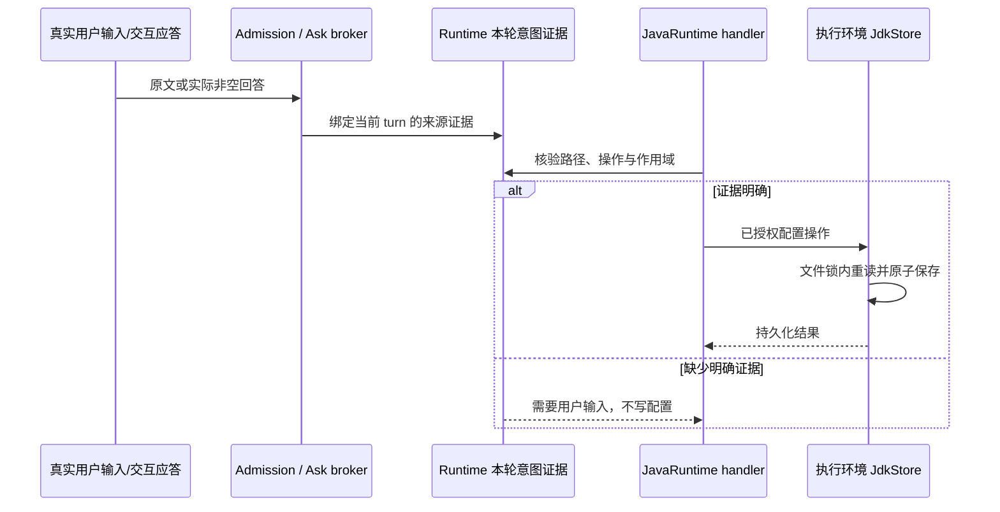

# 对话 JDK 配置的输入来源

状态：实施中，2026-10-16。所属规范见 [Java LSP](SPEC.md)。

JDK 登记默认只增加执行环境候选；项目固定选择、忘记候选均须对应明确用户意图。不得把模型传入的 `confirmed`、AskUserQuestion 的模型输入 `answers`、工具输出、hook 修改或自动超时当成用户输入。用户已经在当前轮明确提供路径时直接复用，不追加相同确认。

唯一意图证据 owner 位于当前 Runtime。真实用户输入由 turn admission 传入原文，追加的真实用户引导也由同一入口登记；下一轮清空该轮证据。子代理指令、自动续跑、系统提醒和恢复的历史文本不登记。证据接口只向 JavaRuntime handler 暴露核验，不提供模型可写的证明字段。

AskUserQuestion 沿用原有交互。broker 仅从实际返回的非空答案构造独立证据，并保留对应可见问题和选项；core 在 permission race 的胜者确为 broker 时登记。hook 赢得竞速时，即使修改后输入带有 answers，也不登记。超时的 `answers: {}` 和用户跳过均没有可用于配置的证据。此标记不从 wire 或工具参数读取，也不修改基础 AskUserQuestion 的输出 schema。

路径必须出现在该轮真实用户原文、实际答案或用户明确接受的问题/所选可见选项中；不能只出现在模型生成的问题里。登记路径采用已确认的环境候选默认；固定项目和移除候选另核验对应明确动作及作用域。模糊或否定回答不授予配置操作，返回需要用户提供具体信息；不在后台重复询问或自动选择 JDK。项目键由宿主当前 workspace 产生，不能通过文字证明跨越到另一 workspace。

持久配置使用 `version: 1`、`candidates` 路径数组和 `projectSelections[projectKey].project/build`。`getConfiguration` 返回独立只读快照；`forget` 只移除登记，不删除 JDK 文件；该路径仍被显式项目选择引用时拒绝，须先明确清除绑定，避免隐式影响多个项目。每次修改复用进程内队列和跨进程文件锁，并在锁内重读，不用旧快照覆盖其他会话修改。

`JavaRuntime.clearSelection` 清除当前执行上下文项目的明确绑定，`purpose` 缺省为 `project`，构建 JVM 使用 `build`。它不要求用户重新抄写路径，不移除环境候选或 JDK 安装。仅本轮真实原文或实际问答明确要求清除、取消或解除当前项目的 JDK 固定/选择时执行；清除构建选择还须有明确构建/Gradle/build JVM 语境。普通“不使用某路径”、模型建议或没有回答的问题不授予清除或删除候选资格。清除后项目恢复自动匹配；若没有其他项目引用，后续明确的 `forget` 才可移除登记。
