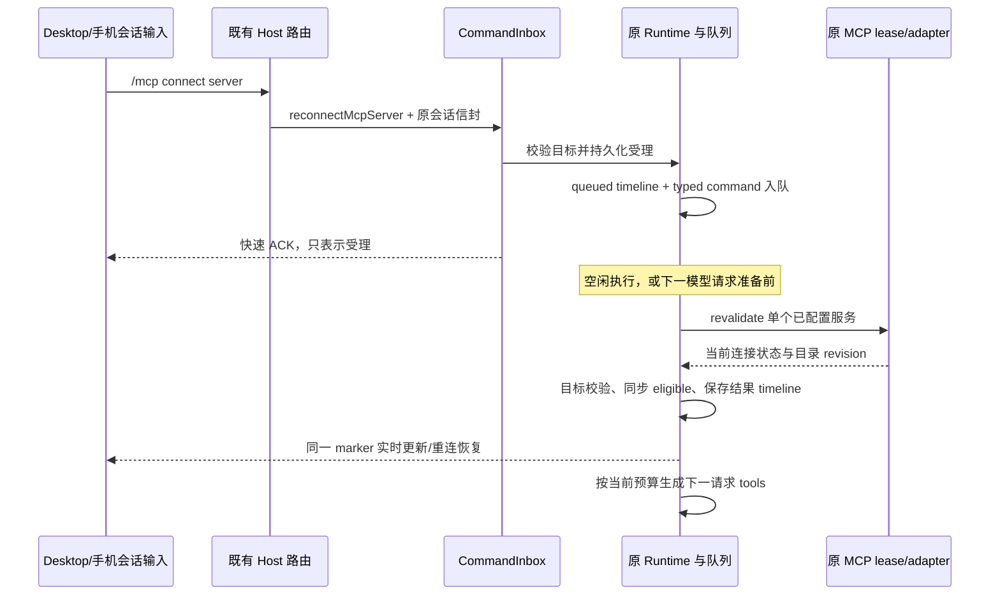

# MCP 原会话连接恢复

状态：已实现，核心、双传输模式及真实桌面验收通过。更新：2026-10-16。所属规范：[ToolSearch](SPEC.md)，证据与未执行范围见 [验证记录](../VERIFICATION.md)。

## 已确认范围

- 用户确认先实现 MCP 会话恢复，再推进 Java LSP；入口使用会话内 `/mcp connect <server>`，运行中的恢复在下一次模型请求前处理。
- Desktop 与手机 Web 共用会话命令入口；首版 GUI 仅提供 connect，缺少服务名、不支持的子命令或携带附件时返回用法，不把命令发给模型。CLI 已有 list/status/disconnect 保持现状。
- 操作目标是已有会话配置中的单个 MCP 服务，不能注入 command、URL、env 或新服务配置；不创建/替换会话，不使用独立 mcp-status 进程，不增加 Agent 基础工具、自动轮询或定时重试。
- 输入框没有已建立的会话时给出明确提示，不为连接命令新建会话或启动模型轮。会话恢复不依赖模型可用性。

## 问题依据与所有者

首次连接失败且没有 descriptor 时，ToolSearch 没有可加载目标，也无法借工具调用触发重连。Desktop 的 `mcp/list` 使用独立控制面进程，不能恢复原 Runtime 的 lease。已有 `app.connectMcpServer` 能定位会话配置；连接池需要 `revalidate: true` 才会重试已失败的连接结果。

| 事实                                       | 唯一所有者                                                                       |
| ------------------------------------------ | -------------------------------------------------------------------------------- |
| workspace/session 与 owner/attachment 路由 | 既有 Host 与会话 V4 传输，保留 workspaceIdentity、workspacePath、remoteSessionId |
| 命令准入、commandId 去重                   | CLI CommandInbox；持久受理事实复用已有 command fact 存储                         |
| 待执行恢复、执行边界与取消                 | 原 Agent Runtime 的 runtimeCommandQueue；不新增客户端或第二条服务端恢复队列      |
| 连接、OAuth、descriptor/revision           | 该 session 的 MCP lease/adapter                                                  |
| 工具资格与模型暴露                         | 原 Runtime registry 与 ToolExposureState                                         |
| 恢复结果历史                               | Runtime 持久 timeline part；V4 marker 与 UI 均为派生投影                         |

## 协议与执行规则

V4 命令名为 `reconnectMcpServer`。沿用 envelope 的 sessionId/clientId/commandId 与外层 workspace 路由，payload 仅包含 `serverName` 和 `expectedForegroundExecutionId`（空闲时为 null）。携带 `baseLogEpoch` 防止旧分支操作落到新分支；不对高频变化的 revision 做 CAS。命令接受后返回 `{ type: reconnectMcpServer, serverName, disposition: queued }`，只代表受理，不代表已连接。

1. CommandInbox 校验既有会话、log epoch，原 Runtime 核对前台执行 ID；将命令绑定当前 branchGeneration 与 regular turn/启动 reservation。会话忙于无法提供模型请求边界的维护阶段时明确拒绝，不把请求留给未来无关 turn。
2. 同一 admission 先持久化受理/queued marker，再加入现有 runtimeCommandQueue，并快速释放会话 admission gate。等待网络或模型边界不能阻塞 Stop 等后续命令；相同 commandId 重试只回放既有受理事实。
3. 空闲命令由原 Runtime 队列执行；regular turn 中在每次模型请求准备前处理，包括首请求准备和输出恢复步骤。先完成既有 MCP 初始化屏障，再恢复并同步当前目录，最后生成 Exposed/schema；恢复本身不插入新的用户输入或发起模型调用。
4. 执行前重新检查服务仍配置、启用、可信且具备当前会话资格。只使用该 App 的配置与 lease；不能借子代理的只读 borrowed port 修改父连接生命周期。当前已连接/仍有有效连接任务时复用状态，失败/断开时通过 revalidate 重连，不无条件关闭共享连接。
5. 连接参数保留当前 trace、workspace identity、取消信号与既有 OAuth 等待预算。成功后同步 registry 与目录版本，回报该会话当前获准工具数量；不自动加载该服务全部 schema，也不改变执行审批。等待授权与失败如实记录，OAuth 仍沿用原 adapter 的授权与后续目录提交机制。
6. 已绑定 turn 的恢复请求在该 turn 结束或取消后取消，不降格为下一 turn 的动作。执行前后检查 branch/前台目标/shutdown/signal；过期结果不能写入新分支或新会话。owner 关闭时取消并回收自身待执行/在途工作。

`baseLogEpoch` 只补齐本命令和既有行目标命令的代次约束，不扩大现有 revision CAS 语义。workspace 身份保留在已有外层路由中，不在 payload 中制造第二份身份事实。

## 状态与恢复投影

共享 schema 定义 `McpReconnectState`：`sourceCommandId`、`serverName`、`phase`，以及可选 `toolCount`、`catalogRevision`、`reason`、`failureKind`。phase 为 queued、connecting、connected、awaiting_authorization、failed、cancelled、interrupted。reason 使用有界摘要，不含凭据、完整配置或 schema；等待授权复用现有授权流程，不把历史授权链接当作当前有效链接。

- Core 发出 typed `mcp_reconnect_updated` 事件并以 `timelineType: mcp_reconnect` 保存同一操作的 timeline part；sourceCommandId 与稳定 message/part ID 关联 queued、connecting 和结果，更新同一记录。
- V4 投影为 `timelineMarker`，`marker.type: mcpReconnect`，其余字段使用同一共享状态 schema。marker 为独立可见的轻量状态记录，不伪造 ToolCall 或模型 Turn，也不进入模型上下文。
- Desktop continuous 与手机 replayable 使用同一 marker 事实、delta/snapshot 和历史 hydration。UI 只渲染，不持有另一个连接状态；ACK 收口本地发送 overlay，不把 queued 展示成成功。
- 持久去重只证明操作已受理。冷恢复时未终结的 queued/connecting 显示 interrupted，不自动重放该恢复命令；再次恢复须新的用户命令。会话启动时原有 MCP 初始化策略保持不变。完成、失败与取消历史保持原结果。fork/rewind 沿现有时间线锚点裁剪，不把旧操作自动带入新 Runtime 执行。

## 核心验收

- 首次服务启动失败且无工具，修复外部条件后在原 Desktop 会话输入命令：不重建 session，恢复成功后 ToolSearch 可发现并执行只读工具。
- regular 模型步骤被受控屏障阻塞时提交恢复：ACK 及时返回；放行后下一请求使用新目录。Stop/turn 结束或分支切换不会把该请求执行到后续 turn。
- 相同 commandId 重试、ACK 丢失或手机断线重连不重复连接；cold resume 显示中断而非自动重放。只选代表性状态，不做完整组合矩阵。
- 禁用、未知服务和越权/借用端口拒绝，已有资格与工具预算不改变；已连接目标不被无故断开；连接错误和等待授权不显示成功。
- Desktop 和手机共用 slash 解析、状态文案及 marker；合法命令和 usage 错误都不调用模型。验证真实桌面首次失败→修复→同会话恢复，并用协议恢复用例覆盖 replayable 语义；未执行的实机范围如实记录。

临时 `.test.ts` 及验收脚本执行后删除，真实证据记入 [验证记录](../VERIFICATION.md)。本轮不提交或推送代码，除非用户另行明确要求。
