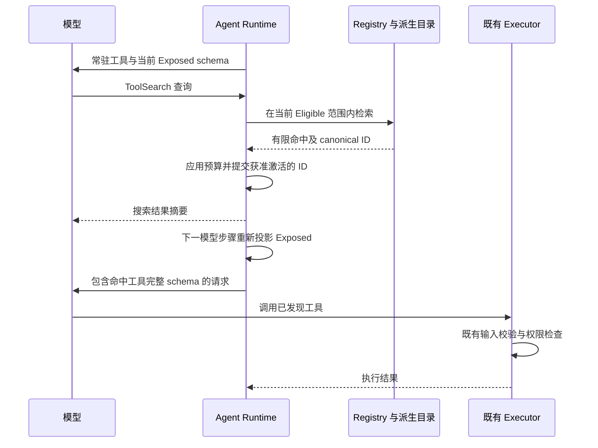
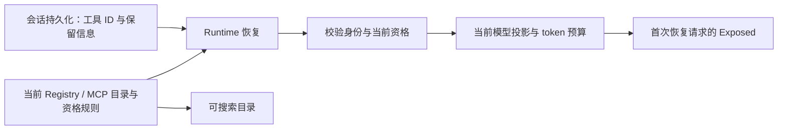

# Agent 工具搜索与按需暴露

所属专项：[Agent 工具优化](../SPEC.md)。

## 状态与范围

- 状态：**已实现**。ToolSearch 与 ApplyPatch 联合验证及真实 OpenAI Responses 请求结果见 [验证记录](../VERIFICATION.md)；客户端实机验收仍未执行。
- 已确认目标：增加工具搜索，同时覆盖基础 Agent 工具与 MCP 工具，减少同时发送给模型的工具描述和 schema。
- 已确认首版常驻名单、受限子代理自动补入发现入口、32,000 个估算 token 的可调总预算、单次最多加载 5 个，以及跨模型调用、用户消息、compact 和冷恢复的保留原则。
- ApplyPatch 作为常驻的内置基础工具接入同一目录。LSP、AST、DependencyGraph 及软件开发插件方案保留设计待定，本轮不注册这些工具；目录不依赖其实现。各自设计见 [专项总览](../SPEC.md)。
- 首版目标是减少模型请求中的工具定义；MCP 延迟连接、服务端生命周期调整、向量数据库及自动调用搜索结果不属于本设计范围。

## 已确认的首版规则

### 常驻与按需加载

通用常驻候选名单共 18 个，实际发送时仍与当前 eligible 目录取交集：

| 类别       | 工具                                                               |
| ---------- | ------------------------------------------------------------------ |
| 文件与命令 | `Read`、`Write`、`Edit`、`ApplyPatch`、`Bash`                      |
| 网络       | `WebFetch`、`WebSearch`                                            |
| 任务与计划 | `TodoRead`、`TodoWrite`、`EnterPlanMode`、`ExitPlanMode`           |
| 交互与会话 | `AskUserQuestion`、`SendMessage`、`TaskStop`、`ReadSessionContext` |
| 工具发现   | `ToolSearch`                                                       |
| 能力入口   | `Agent`、`Skill`                                                   |

对应角色的控制工具也在获得既有使用资格时直接常驻：

| 工具                   | 既有资格条件                                 | 用途                        |
| ---------------------- | -------------------------------------------- | --------------------------- |
| `RespondToCoordinator` | `subagent_child` 且具有协调者回复端口        | 回复协调者消息与进度反馈    |
| `submit_result`        | 注入工作流结果提交端口，并通过既有工具白名单 | 提交工作流 ask 的结构化结果 |
| `escalate`             | 注入工作流升级端口，并通过既有工具白名单     | 向工作流协调者请求处理阻塞  |

- 通用常驻候选包括 `Agent`、`Skill` 两个能力入口；按用户确认，以 `SendMessage` 替换 `TaskOutput` 的常驻位置，总数仍为 18 个。另有以上三个仅在对应角色获准时出现的控制工具；18 个通用候选和 3 个角色候选不代表同一会话会加载全部 21 个。
- 常驻规则由 Runtime 既有 `RESIDENT_TOOL_NAMES` 唯一声明，角色资格沿用注册端口和现有过滤规则，不增加第二套角色状态。首次请求即携带获准定义，计入常驻预算，预算收紧或 compact 不使其转为按需；角色控制工具不依赖 ToolSearch 成功才能完成回复、提交或求助。旧会话按当前常驻名单重新投影，不要求历史中存在搜索记录；以前按需激活、现在已转常驻的工具，其旧激活标记在投影预算前移除，避免把常驻成本误当成可回收空间。不迁移持久化格式；显式禁用和白名单仍优先。
- `SendMessage` 在既有子代理消息端口和权限允许时随首请求提供完整定义，与常驻的 `Agent` 配套。`TaskOutput` 保留按任务 ID 查询、等待和获取结果的能力及原有别名，但新会话首次请求不自动携带其定义；经 ToolSearch 命中后，下一步骤提供完整 schema。预算不足时沿用现有未加载结果，不因原先常驻而绕过预算。
- 常驻替换不新增持久化格式或迁移路径。旧 `SendMessage` 按需激活记录由现有 prepare 流程清理；旧会话中的 `TaskOutput` 若没有有效激活快照，恢复后按需发现，有有效快照则按既有资格和预算规则复用。状态仍由 Runtime ToolExposureState 唯一拥有，恢复与请求投影继续沿用下文流程图。
- 其余获准工具按需加载，包括 `TaskOutput`、工作流编排/查询、定时任务、MCP 工具，以及尚待实现的 `LSP`、`AST`、`DependencyGraph`。文件搜索继续采用现有 Bash embedded-search 分支；不因本次调整恢复 `Glob`、`Grep` 或启用内置 `js`。本次常驻替换不修改 ToolSearch 搜索参数或过滤规则；此前真实模型调用携带错误 server 过滤导致零命中的问题仍需另行处理。未实现的工具不能仅因写入规范就出现在可搜索目录中。
- 常驻名单不绕过模型能力限制或扩大子代理的业务工具权限；除下述发现入口外，原本不可用的工具不会因常驻配置而获得使用资格。
- 对已有显式 allowlist 的受限子代理，Runtime 自动补入并常驻 `ToolSearch`，无需修改现有 profile 才能发现工具。该入口只搜索原有有效白名单中的工具，保留既有 `RespondToCoordinator` 补入规则；同时继续应用模型能力、功能开关及禁用规则。
- 自动补入仅增加发现入口，不补入父会话的其他工具、不把原白名单改成通配范围，也不授予执行许可。显式禁用规则仍生效，不能被自动补入覆盖；搜索命中的工具按原权限链执行。
- 从模型上下文卸载工具，只是不再携带其定义；它仍在 eligible 目录中，可再次搜索。真正被禁用、移除或不再获准的工具，不得通过搜索或恢复会话重新获得。

### 模型发现引导

- ToolSearch 的工具描述明确要求：任务需要当前工具列表中缺失的专用能力时，先调用 ToolSearch，再决定是否使用通用工具替代或报告能力不可用；支持按准确工具名或简短能力关键词搜索。
- 默认会话的既有 session guidance 在获准目录包含 ToolSearch 时补充同一原则，说明工具定义按需加载，当前列表并非全部可用能力。指引限定当前请求提供 ToolSearch 时才调用，兼容本轮临时禁用；会话目录没有 ToolSearch 时不输出该指引。
- 已有合适工具时直接使用，不要求每次操作都搜索。搜索成功后等待下一模型步骤提供完整 schema，再调用命中工具；搜索本身不执行工具，也不搜索项目文件内容。零命中或预算不足时根据结果调整查询或使用已有替代能力，不重复原样搜索。
- 发现引导仅作用于模型可见说明，不自动代替模型调用 ToolSearch。常驻和预算调整以本规范对应章节为准；搜索算法、执行权限、文件搜索分支和工具执行流程沿用既有行为。工作流 actor 与 custom system prompt 沿用原有 prompt 替换边界；其中可用的 ToolSearch 同样携带加强后的工具描述。
- 核心验收检查实际上下文构建结果中的条件引导、缺少 ToolSearch 时无该提示，以及工具描述包含主动发现和下一步骤调用规则。提示生成测试不能证明真实模型在所有任务中都会主动搜索。

### 预算口径

- 主要限制按需加载工具定义的 token 开销，不仅按工具数量限制；每次搜索只激活少量最相关的结果。
- 同时记录常驻开销与请求中工具定义总量：`工具定义总量 = 当前获准常驻工具开销 + 当前已加载按需工具开销`。同一 canonical ID 只计一次。
- 预算依据当前模型投影后实际送入 provider 转换流程的定义估算，包含名称、描述与输入 schema；provider-specific 转换带来的差异需注明。不能用源文件字节数或工具数量冒充实际 token。
- 现有上下文估算包含内部 metadata 和 output schema，与 provider 实际发送字段不同；两种统计口径需分别标注，不能直接混用作预算或宣称精确节省。
- 用户已确认默认总预算为 32,000 个估算 token，包含常驻定义；每次最多加载 5 个工具。这些值通过配置可调，预算对象仅为工具定义，不代表整个模型请求 token 上限。32,000 仅替换未显式配置时的默认值；已有用户、项目或 Runtime 显式预算（包括 16,000）保持优先，不改写配置文件。提高上限不预加载工具。
- 同一轮已加载工具保持稳定；需要空间时，优先淘汰之前轮次最久未用的工具。仍放不下或单个 schema 过大时，返回未加载原因，不截断 schema 或静默突破预算。常驻定义自身超限时保留常驻并暂停新增加载；资格或显式禁用变化仍立即生效。
- 搜索结果摘要、历史工具结果和搜索增加的模型步骤同样有上下文/调用成本，评估收益时一并记录；它们不属于工具定义预算本身。

实施前的 [定义开销基线](SCHEMA-BASELINE.md)：基准配置下 14 个原有常驻工具的模型字段约为 **7,948 个估算 token**，不含新增的 `ToolSearch`。原内部口径为 18,788，包含额外元数据，不能直接作实际发送量。运行时使用当前模型的工具定义估算；默认总预算为用户已确认的 32,000。

### 保留策略

| 边界                          | 已确认行为                                                                                              |
| ----------------------------- | ------------------------------------------------------------------------------------------------------- |
| 同一轮任务中的连续模型调用    | 保持已加载工具稳定，不每步清空或反复要求搜索；资格与目录变化仍即时生效。                                |
| 用户发送下一条消息            | 预算允许时继续复用，优先保留最近实际使用的工具；不按消息边界无条件重置。                                |
| 上下文压缩（compact）         | 整理长期未使用的按需工具，保留获准常驻工具和当前任务必需工具；压缩不触发全量装载。                      |
| 重启后恢复会话（cold resume） | 保存已加载工具标识，按当前目录、模型、资格和权限重新加载仍有效的定义，并应用预算；不直接恢复旧 schema。 |

“首版实现决策”将上述保留原则具体化为轮次保护、LRU、compact 和历史快照规则。

## 当前源码基线

当前实现接点如下；行为验证状态见末尾。

| 事实                                                                                       | 源码依据                                                                                                                                        |
| ------------------------------------------------------------------------------------------ | ----------------------------------------------------------------------------------------------------------------------------------------------- |
| 内置与 MCP 工具最终进入同一个 ToolRegistry；`toContracts()` 输出 provider-visible contract | `apps/zcode-cli/packages/core/src/tool/registry.ts:104`                                                                                         |
| MCP 启动快照经会话 allow/disallow 过滤后注册，并使工具缓存失效                             | `apps/zcode-cli/packages/core/src/runtime/methods/mcp.ts:105`；`apps/zcode-cli/packages/core/src/mcp/index.ts:41`                               |
| `getTools()` 缓存完整可见集合，再按模型投影 contract                                       | `apps/zcode-cli/packages/core/src/runtime/methods/config.ts:137`                                                                                |
| 每个模型步骤通过 `getExposedTools` 获取常驻与已激活集合，并叠加当前 turn 的禁用规则        | `apps/zcode-cli/packages/core/src/runtime/helpers/tool-exposure.ts`；`apps/zcode-cli/packages/core/src/runtime/methods/turn-loop.ts`            |
| 子代理继承基础工具时使用父 runtime 的 `getTools()`；MCP 借用父启动快照                     | `apps/zcode-cli/packages/core/src/runtime/methods/subagent.ts:459`                                                                              |
| 显式子代理 allowlist 补入 `ToolSearch` 和已有的协调工具；显式 disallow 仍生效              | `apps/zcode-cli/packages/core/src/runtime/helpers/tool-allowlist.ts`                                                                            |
| 插件引用提示和上下文 guidance 也使用 `getTools()`，不能直接改成已加载集合                  | `apps/zcode-cli/packages/core/src/runtime/methods/plugin-reference.ts:28`；`apps/zcode-cli/packages/core/src/runtime/methods/context.ts:144`    |
| compact summary 请求不携带工具，成功后应用 compact 保留快照                                | `apps/zcode-cli/packages/core/src/runtime/methods/compact-active.ts`；`apps/zcode-cli/packages/core/src/runtime/methods/compact-persistence.ts` |
| 请求工具已按内置/MCP schema 分别估算上下文占用                                             | `apps/zcode-cli/packages/core/src/runtime/methods/context-usage.ts:142`                                                                         |
| provider adapter 把请求 tools 转成 AI SDK 工具；当前没有 deferred tool contract            | `apps/zcode-cli/packages/adapters/src/model/tool-transform.ts:20`；`apps/zcode-cli/packages/contracts/src/model/index.ts:460`                   |

## 设计边界与状态所有者

拟将工具定义、可搜索资格、模型暴露和执行许可分开，避免把“尚未加载”解释为“不可使用”。

| 概念                  | 所有者与来源                             | 含义                                                                      |
| --------------------- | ---------------------------------------- | ------------------------------------------------------------------------- |
| Registry              | 当前 Agent Runtime 的既有 ToolRegistry   | 已注册工具定义、canonical name、handler 的单一事实源                      |
| Eligible 目录         | Runtime 从 registry 及现有可见性规则派生 | 当前会话、子代理、模型和 turn 有资格发现的工具；不授予执行许可            |
| 搜索索引              | Eligible 目录的可重建派生数据            | 名称、别名、描述、来源等检索字段；不复制 handler 或独立维护权限           |
| 激活状态              | 当前会话 Runtime                         | 已加载 canonical tool ID 及支持保留策略的使用信息；跨消息复用，冷恢复重验 |
| Exposed 集合          | Runtime 按请求派生                       | 常驻工具与已激活工具的并集，再与当前 eligible 集合取交集                  |
| 执行许可              | 既有 executor、permission service/broker | 实际调用仍按工具输入、模式和权限策略执行检查                              |
| MCP 连接与 descriptor | 既有 McpPort/adapter、启动快照           | 是否已连接与是否向模型发送 schema 是两个不同状态                          |

- 不把 `providerVisible: false` 的隐藏兼容入口通过搜索重新暴露；名称别名仍解析到既有 canonical identity。
- 保留既有模型能力限制、功能开关、子代理原有有效 allowlist、结构性禁用和 turn disallowlist。受限子代理的 `ToolSearch` 入口按已确认规则补入，检索与激活目标仍来自原获准目录，不因入口补入而扩大。
- 不直接重定义现有 `getTools()` 的全部语义；应区分“查询获准目录”和“构建本次请求 tools”的调用接口。
- 子代理继承自己的获准目录，再维护自己的激活状态；父会话尚未激活某个工具，不应缩小子代理的资格范围。
- MCP 搜索复用现有已发现 descriptor；加载 schema 不代表重新连接、授权、安装插件或调用该工具。
- schema 加载成功不代表 LSP server 已就绪；实际 LSP 调用遵守其独立生命周期和错误语义。卸载 `LSP` 定义也不等于关闭语言服务，不改变已确认的文档同步与编辑后诊断反馈规则。
- 工具搜索及激活状态位于执行会话的 Runtime；Desktop Main、relay、Renderer 均不成为第二状态所有者。
- 隔离键保留 `workspaceIdentity?.trim() || workspacePath`，并区分 session；远程调用保留 `remoteSessionId`，不按路径合并不同远端目录。

## 拟议工具接口与事件顺序

工具暂名 `ToolSearch`，作为发现入口常驻。它检索工具能力，不搜索文件内容或网络。

| 输入/输出 | 拟议语义                                                             |
| --------- | -------------------------------------------------------------------- |
| 查询输入  | 接受名称或能力描述；支持明确工具名称匹配，具体字段及语法在实现前定稿 |
| 可选筛选  | 可按内置/MCP 来源或 MCP server 缩小范围；不能越过 eligible 目录      |
| 结果上限  | 默认最多 5 项，可通过 maxResults 调整，并受总 schema token 预算约束  |
| 成功结果  | canonical name、简短说明、来源和激活结果；只返回命中的有限集合       |
| 零命中    | 返回空结果及简短说明，不自动放宽资格或装载全部工具                   |

首版建议采用确定性的名称、别名、描述及来源匹配，保持同一目录与查询下的结果稳定；不增加独立 LLM 检索调用。

- 搜索成功只改变工具暴露状态，不执行命中工具；重复激活同一 canonical ID 不重复添加 schema。结果中的激活状态必须与下一请求实际可携带的集合一致，不能把未通过预算的候选标为已加载。
- 激活提交必须先于下一模型步骤构建 tools；不能用延时等待处理顺序，也不能要求模型仅凭结果中的文字猜参数。
- 完整 schema 放入下一次请求的 tools，结果消息只放摘要，避免两处重复发送 schema。
- 若搜索失败或取消发生在提交之前，不产生新的激活结果；后续请求仍按当前 eligible 状态重新过滤。
- 目录更新、禁用规则变化或模型切换后，重新投影相关 schema；失效 ID 不再进入请求，不执行旧 handler。
- 首版采用 provider-neutral 客户端工具流程，不依赖某一家 API 的 `defer_loading` 或 `tool_reference`。

## Context、缓存与恢复

- Context guidance、插件引用提示、子代理继承和持久化中的工具快照，应逐一指定需要 eligible 还是 exposed，不能统一替换为同一集合。
- 插件已连接且其工具可搜索时，应能被正确识别；不能因为尚未向模型加载 schema 就显示为不存在。
- Exposed 输出采用稳定顺序，避免无意义重排；激活、目录或规则变化只使相关派生缓存失效。
- 分别记录实际请求的常驻/按需定义估算、现有 `system_tool_schemas`/`mcp_tool_schemas` 分类估算与 provider usage，注明各自口径，记录额外模型步骤及任务完成情况。
- compact summary 是否携带哪些工具，应独立于正常执行步骤定义；现有“超过 100 个全部移除”的规则不能直接当作新预算。
- 激活 ID 和使用信息通过既有 message/tool part 的 `metadata.toolExposure` 保存，不使用 compact 自然语言摘要恢复，也不新增平行状态文件。
- 恢复顺序是先获得当前 registry/MCP descriptors 与资格规则，再校验保存的 ID，应用当前模型投影和预算，最后生成首次恢复请求的 Exposed。不能先发送历史 schema，再异步撤销失效工具。
- 工具已移除、禁用或当前无发现资格时不恢复；恢复不能授予执行权限，实际调用仍进入既有 permission 流程。需要逐次审批的工具不因恢复标识就变成已批准执行。
- 使用同一目录事实重建搜索索引与 Exposed；持久化标识不能重新注册旧 handler。MCP server 或工具目录发生变化时按当前身份校验，不凭相似名称替换为另一个工具。
- 冷恢复、rewind 和 fork 均使用有效消息边界内的结构化快照，具体规则见下文。
- Desktop `desktop-continuous` 与手机 `web-remote-replayable` 继续连接同一会话事实；客户端重连不应单独激活工具或另起搜索状态。

## 首版实现决策

- 配置文件使用 `toolSearch.schemaTokenBudget`（正整数，默认 32,000）与 `toolSearch.maxResults`（正整数，默认 5，可调）。两个字段逐项合并，优先级沿用当前配置入口：系统默认 → 用户 `config.json` → 项目配置（根目录到 cwd，再到显式项目配置）→ CLI 配置覆盖 → `options.runtimeConfig.toolSearch`。最后一层运行时覆盖优先级最高，未提供的字段保留低优先级值；本轮不新增环境变量或设置 UI。
- 默认值由 contracts 的 `DEFAULT_TOOL_SEARCH_CONFIG` 唯一定义，配置端口和 Agent Runtime 共用；配置文件经运行时 schema 校验后传入 bootstrap，再注入会话 Runtime。验收覆盖部分字段跨用户/项目层合并、非法范围拒绝，以及 runtime override 的字段级优先级。

- Runtime 配置入口为 `AgentRuntimeConfig.toolSearch`，默认总预算 32,000 estimated tokens、每次最多 5 项，均可调。预算为当前模型转换后的工具定义估算，非 provider tokenizer 的精确计数；自定义 Model 未提供估算接口时仅估算 name、description、inputSchema。
- 输入为 `query`，可选 `source: all | builtin | mcp`、`server` 和 `limit`；精确名称与别名优先，其次按名称、说明、能力及 MCP 来源的关键词匹配稳定排序。只返回匹配的有限摘要，不回传完整目录或 schema。
- Runtime 持有唯一 `ToolExposureState`。本轮新激活或实际调用的工具受保护；旧轮加载但本轮尚未使用的工具可按 LRU 回收。检索多个命中时先在副本完成预算判断再提交，拒绝项不驱逐其他工具，也不截断 schema。
- 使用标记在 executor 通过权限检查、进入 handler 之前更新，避免同批后续搜索先于终态持久化而误驱逐刚调用的工具；终态持久化仍更新最近使用顺序并保存快照。
- 常驻定义超预算时保留常驻并暂停新激活。模型变化或目录变更重新校验资格及大小；已无资格的工具立即退出暴露集合。
- 每次实际工具调用完成时，在该 tool part 的结构化 metadata 保存版本化快照；assistant message 与 compact summary 同样携带快照。仅保存 canonical ID、最近激活/实际使用顺序及 revision，不保存 schema 或 handler。
- compact summary 请求不带工具；成功压缩保留本轮受保护工具及上一轮实际使用的工具。压缩快照随 summary 持久化，失败不提交压缩后的激活状态。
- cold resume 与 conversation rewind 从 `activeSessionMessages` 的有效历史中恢复最近 revision 的快照，再按当前目录、模型及预算投影。旧会话没有快照时从常驻开始。fork 只继承复制消息范围内的快照，不读取父 Runtime 此刻的加载集合。workspace-only rewind 不改变对话激活状态。
- 上述快照属于会话 Runtime，Desktop continuous 与手机 replayable 共用同一持久事实；客户端断线重连不触发新激活。

## 计划验收

以下为产品验收范围；本地已执行的核心场景及尚未执行的外部验证分别记录在末尾：

1. **常驻与混合工具发现**：新会话首请求含获准的 18 个通用常驻候选，包括完整 ApplyPatch、Agent、Skill、SendMessage schema，无需先搜索；普通主会话不注入角色控制工具。TaskOutput 首次不加载，准确搜索命中后下一步骤具有完整 schema；其他获准基础工具和 MCP 均可被搜索。搜索命中两类按需工具后，下一步骤具有完整 schema，实际调用成功且结果消息不重复携带完整定义。缺少消息端口、白名单不含或显式禁用时，SendMessage 不因常驻获得资格。证据为模型请求记录、搜索结果和执行事件。
2. **资格与子代理隔离**：子代理原有有效白名单仅为 `Skill` 与 `RespondToCoordinator`、未列 `ToolSearch` 时，首请求自动具有发现入口和两项已获准常驻工具；白名单外的父会话工具不能进入结果和请求。具备提交/升级端口的工作流子代理首次请求直接提供获准的 `submit_result`、`escalate`，预算过低时仍保留；缺少端口、白名单外或显式禁用时不因常驻获得资格。父会话是否已加载目标工具不影响子代理发现资格；被本轮禁用的工具仍被过滤。一次需审批的调用仍到达原权限流程，搜索不绕过审批。证据为子代理原有效白名单、首请求、搜索结果及执行权限事件。
3. **失败与目录变化**：零命中或搜索提交前取消不增加激活；加载后工具被移除或禁用，后续请求排除失效 ID。MCP 已连接但 schema 未加载的工具仍能被搜索，搜索本身不执行工具。
4. **连续使用与预算**：一次搜索后连续调用工具，并发送下一条用户消息；预算允许时复用定义，不重复搜索。使用 schema 大小明显不同的工具验证 token 计量和常驻开销计入总量；预算收紧时按冻结规则优先保留最近使用者，结果中的已激活集合与请求一致。默认预算为 32,000，显式旧预算仍生效；旧快照中由按需转常驻的工具不会造成重复计费或虚假的 LRU 可回收空间。
5. **压缩与冷恢复**：构造正在使用和长期未使用的按需工具，compact 后保留获准常驻与当前任务必需工具，清理项仍可搜索。保存后移除/禁用一个工具再冷恢复，首次请求按当前目录与权限重建有效集合，不复活失效工具，不回到全量暴露。手机重连接入同一会话时不形成另一套状态。
6. **跨 provider 与收益**：至少覆盖实际配置的一条 Anthropic 路径与一条其他 provider 路径；均通过普通 ToolSearch → 下一步骤 tools 完成调用。对比定义估算、现有上下文统计、provider usage、搜索轮数及同一任务完成结果，不只比较工具数量。

## 实施与验证入口

### 审查修复：受限工作流发现入口

显式工具白名单的 `workflow_child` 与 `subagent_child` 都由 Runtime 的白名单解析入口补入 `ToolSearch`，搜索和执行仍受原白名单约束；协调工具继续按各自任务类型注册，不把 `RespondToCoordinator` 注入工作流。显式禁用 `ToolSearch` 仍生效。核心验收使用 `workflow_child` + `tools: ["ApplyPatch"]`：首次请求包含发现入口和常驻的 ApplyPatch，不能发现白名单之外的 Skill；白名单内的其他按需工具仍通过搜索加载，保留普通子代理与显式禁用的验证。

- 实施顺序：用现有 schema 统计冻结预算与边界规则，补充核心场景测试，拆分目录与请求投影，接入 ToolSearch、保留策略及持久化恢复。与 ApplyPatch 联合验收；LSP、AST、Dependency Graph 延后讨论，不阻塞本轮。
- 已核对根 `package.json`：存在 `pnpm typecheck`、`pnpm lint`、`pnpm architecture:check --changed`；这些是代码实施阶段的检查入口，不等同于 ToolSearch 测试。
- 已核对 `apps/zcode-cli/packages/core/package.json`：存在 `typecheck`、`lint`，没有 `test` script；CLI 根也未声明统一测试命令。
- 以下为此前通过 `tsx` 和 `node:test` 执行的验证记录；相关 `.test.ts` 源码已按用户要求删除，后续核心验证使用临时脚本，完成后删除，不随代码提交。
- 已执行 4 项核心测试：名称搜索/去重/超大 schema、当前轮保护与跨轮 LRU、compact 快照恢复并按目录/预算重校验、常驻超额保留。
- 已执行 3 项集成测试：真实 AgentRuntime 与 scripted Model 的搜索→下一请求完整 ApplyPatch schema→文件落盘；真实 SQLite compact、cold resume、fork 边界和 conversation rewind；受限子代理发现入口；已连接 MCP 的按需激活/实际调用、取消不激活和移除后退出请求。
- 已执行 1 项回归：同批先调用旧轮工具、后搜索新工具时，前者在终态持久化之前已被保护。ToolSearch 共 8 项核心/集成测试通过。
- 上述历史测试使用脚本模型；后续真实 OpenAI Responses 请求验证见联合验证记录。Desktop continuous/手机 replayable 端到端场景仍未执行；脚本模型与存储恢复测试不替代这些验证。
