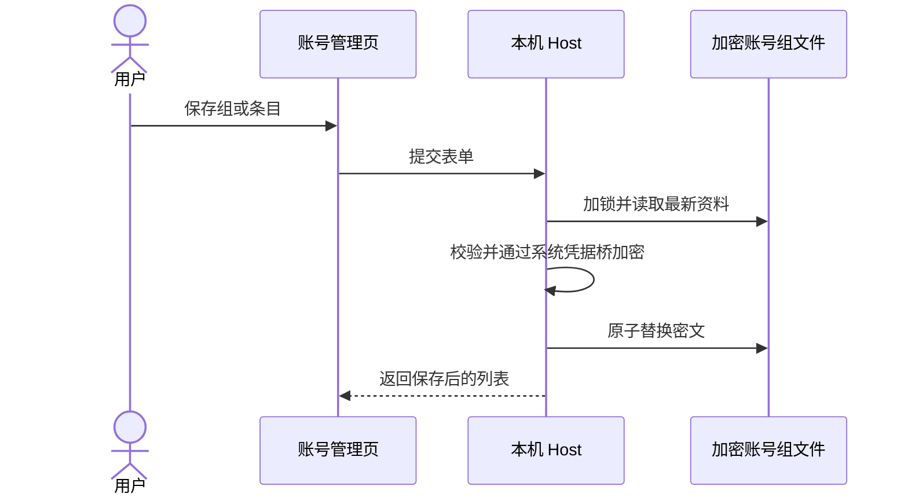

# 环境 · 账号管理

桌面窗口的一级导航在「插件市场」和「模型网关」之间提供「环境」，二级导航提供「账号管理」。入口打开本机账号资料，切换桌面项目时读写同一份资料。

## 管理流程

- 账号组列表位于页面左侧。内置「默认组」固定在列表首位，首次进入时选中，支持管理组内条目和复制整组资料。新建账号组使用带提示的图标按钮，新建后打开新组。自建组的菜单提供复制、编辑和删除。删除前确认，删除当前组后选中默认组。
- 条目列表始终显示「名称」「说明」「类型」「操作」四列表头。空组和筛选无结果时，提示显示在表格内。操作表头和复制、编辑、删除图标在各自单元格居中。窄窗口将账号组放在列表上方，四列表格可在自身区域横向滚动。点击条目名称从右侧查看详情。
- 搜索、类型筛选和新增条目放在组标题右侧同一行，窄窗口将工具栏换到标题下方。搜索匹配当前组的条目名称、说明、字段名和值，可叠加类型筛选。新建条目支持数据库、配置中心、平台账号、API / Key、服务器和自定义模板。模板预填字段，切换新建模板时保留同名字段的值。编辑类型时保留已有字段。
- 新增和编辑账号组、条目时使用居中的弹窗。「说明」输入框沿用设置表单的边框样式。条目表单超出窗口高度时，正文可滚动，底部保存和取消按钮保持可见。
- 条目表单中的「字段名」和「字段值」使用同样的边框和单行高度。字段值随多行内容增高，字段名和移除按钮保持在首行对齐。
- 账号组和条目名称必填，说明选填。条目至少包括一个字段，字段名称必填且在条目内唯一。字段值允许留空和换行，保存、详情与复制均保留原文本。支持复制单值、条目和整组资料。

## 数据与接口

当前桌面的窗口 Host 通过本地 MessagePort 发布账号组服务。服务在应用数据目录读写独立加密文件，使用现有系统凭据密钥桥加解密。文件锁串行化同一数据目录的写入。每次写入读取最新资料，校验后原子替换文件，确认写入后才更新画面。读写失败时显示错误，编辑表单保留草稿。页面选择和筛选由窗口内 UI 持有。

默认组由 Host 按固定 ID 提供。打开已有资料时补入默认组并保留原有分组和条目，下一次保存将默认组一并写入加密文件。界面按当前语言展示默认组名称。

## 验收

从桌面环境页打开账号管理，检查默认组在首位、工具栏对齐和表格内的空提示。用图标新建组，在默认组用数据库模板保存一条含多行字段的记录。确认新增、编辑表单居中且「说明」输入框有边框，字段行在空白时对齐，输入多行后字段值可增高。检查四列、搜索、类型筛选、复制值及同名字段的校验。切回项目再打开账号管理，列表恢复已保存的资料且存储文件是密文。确认条目和自建组删除后的展示。账号管理在窄桌面窗口内可滚动至操作列。
